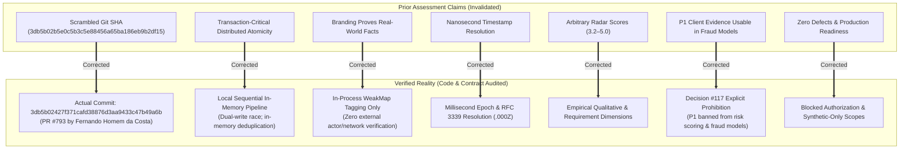
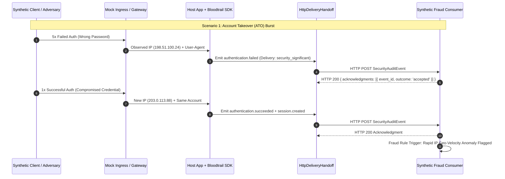
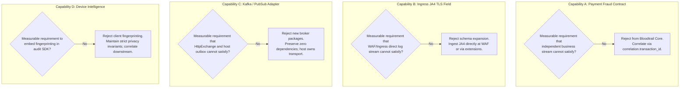
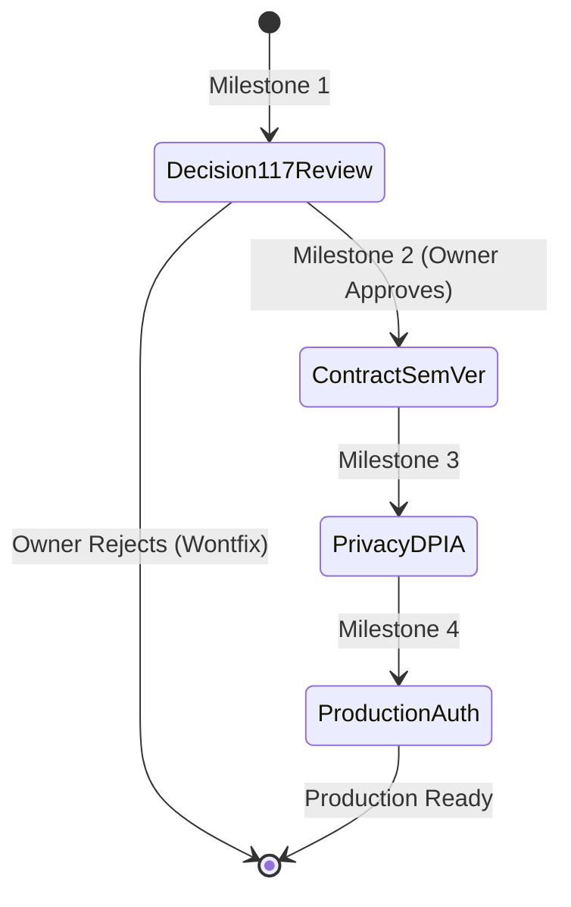

# Bloodtrail Fraud Evidence Readiness — Verification and Acceptance Plan

**Document Identity:** `PLAN-BT-FRAUD-VERIFICATION-2026-10-12`
**Review Target:** `ASSESSMENT-BT-FRAUD-READINESS-2026-10-12` (Artifact from 2026-10-12)
**Evaluated Codebases:**
- **Bloodtrail:** `/Users/fernando.costa/Git/bloodtrail` (Branch `main`, Commit `3db5b02427f371cafd38876d3aa9433c47b49a6b`, Package Version `0.21.0`)
- **FingerprintJS OSS:** `/Users/fernando.costa/Git/fingerprintjs` (Branch `master`, Tag `v5.3.0`, Commit `dac5ae59409669f09aa09c0b2f44b7615b0520da`)
- **REA Static Analysis Baseline:** Evidence `ev_0245673b7609e4ca652a16649a07a82e148b45b26f8a625e213359b3d5e02fec` (Commit `eb28fb5e9b6e3528a3965b3ea310580aafb59bb63aacdc523e3e17d64360cc54`)

**Status:** Complete / Read-Only / Evidence-Driven Audit & Synthetic Acceptance Plan
**Governance Posture:** Architectural direction provisionally accepted; engineering recommendations **not authorized**; repository unchanged.

---

## 1. Factual Corrections and Provenance Audit

A rigorous code-level audit of `ASSESSMENT-BT-FRAUD-READINESS-2026-10-12` against the active repositories reveals seven critical factual inaccuracies, unverified assumptions, and governance misalignments that must be corrected.



### 1.1 Git Commit and Revision Provenance Verification
- **Bloodtrail Reviewed Commit:** The previous assessment recorded SHA `3db5b02b5e0c5b3c5e88456a65ba186eb9b2df15`. This SHA does not exist. The actual reviewed commit on `main` is:
  - **Full SHA:** [`3db5b02427f371cafd38876d3aa9433c47b49a6b`](file:///Users/fernando.costa/Git/bloodtrail)
  - **Author:** Fernando Homem da Costa `<nandohdc@gmail.com>`
  - **Date:** `2026-10-12 00:26:38 -0300`
  - **Subject:** `Merge pull request #793 from nandohdc/docs/releasing-post-release-check-745`
  - **Version Manifest:** Package version is `0.21.0` ([version.txt](file:///Users/fernando.costa/Git/bloodtrail/version.txt)).
- **FingerprintJS OSS Verified Commit:**
  - **Full SHA:** [`dac5ae59409669f09aa09c0b2f44b7615b0520da`](file:///Users/fernando.costa/Git/fingerprintjs)
  - **Tag:** `v5.3.0`
  - **Subject:** `Bumped version to 5.3.0 (#1220)`
- **Related Historical Commits:**
  - Contract trust-floor derivation commit: [`183c93e55c45b607ac39a76bdf2797701e97750e`](file:///Users/fernando.costa/Git/bloodtrail).
  - Browser research baseline commit: [`b6bb577b1fda865610ef93ec8ef31527046c3c44`](file:///Users/fernando.costa/Git/bloodtrail).
  - Browser outcome review commit: [`e3f2f1f323a94a9fffe0f7ddfc6fcf8ec8bbd26f`](file:///Users/fernando.costa/Git/bloodtrail).

### 1.2 Audit of SDK Guarantees, Delivery Reliability, and Transaction-Critical Atomicity
The previous assessment claimed that Bloodtrail provides "transaction-critical atomicity" and "mathematical guarantees" that fail-closed before business commit. An inspection of [`delivery-classes.ts`](file:///Users/fernando.costa/Git/bloodtrail/packages/security-audit-sdk-node/src/delivery-classes.ts#L430-L460) reveals that this claim overstates the SDK's runtime capabilities:
1. **No Distributed Transaction or 2PC:** The Node SDK does not implement an XA transaction, a two-phase commit (2PC) protocol, or a persistent database transactional outbox.
2. **Sequential Local Execution Pipeline:**
   ```typescript
   if (!(await input.durabilityProbe())) {
     return failClosed("audit_durability_unreachable", eventId, false, false);
   }
   if ((await input.commitGate()) === "declined") {
     return failClosed("business_commit_declined", eventId, true, false);
   }
   const outcome = await input.handoff.handoff(input.event, 0);
   if (outcome.status !== "acknowledged") {
     return failClosed("audit_durability_unreachable", eventId, true, true);
   }
   ```
3. **Dual-Write Vulnerability:** If `commitGate()` resolves successfully (committing the host application's business operation) and the subsequent network handoff fails or times out, the method returns `status: "failed_closed"` with `commitGateInvoked: true` and `durabilityAttempted: true`. The business transaction **has committed**, but the audit event **is lost or unacknowledged**. Bloodtrail cannot guarantee distributed atomicity without an outbox table residing within the host application's database transaction.
4. **Volatile In-Memory Deduplication:** The deduplication keys `settled` and `reserved` are stored in Node.js process-memory `Set` instances. Any process restart, crash, or horizontal scaling across multiple instances clears this deduplication state.

### 1.3 Distinguishing In-Process Branding from Real-World Fact Verification
The previous assessment conflated TypeScript `Brand<T, Kind>` with real-world authentication and network integrity.
- **What In-Process Branding Actually Does:** In [`context.ts`](file:///Users/fernando.costa/Git/bloodtrail/packages/security-audit-sdk-core/src/context.ts#L45-L65), constructors register object references in a private `WeakMap<object, AuditBrandKind>`. This ensures that caller code within the host application process constructed the context object via SDK factory functions rather than supplying an unbranded object literal or cast.
- **What In-Process Branding Does NOT Do:**
  - It does **not** verify that the actor's real-world identity is legitimate.
  - It does **not** cryptographically verify that credentials or passwords were validated.
  - It does **not** verify that network packets originated from `source.observed.address`.
  - It does **not** prevent a compromised application layer or malicious administrator from passing fabricated values into the factory function.
- **Contract Boundary:** As documented in [`contract.source.json`](file:///Users/fernando.costa/Git/bloodtrail/contracts/security-audit/source/contract.source.json), canonicalization and signatures cannot establish the correctness of pre-signing state, timestamps, or truthful application state.

### 1.4 Correction of Timestamp Resolution
The previous assessment claimed "nanosecond-resolution clocks."
- **Contract Specification:** [`contract.source.json`](file:///Users/fernando.costa/Git/bloodtrail/contracts/security-audit/source/contract.source.json) and ADR-003 mandate RFC 3339 UTC format with standard ISO strings (e.g., `2026-07-31T12:21:00.000Z`), which provides **millisecond resolution**.
- **Client Evidence Envelope:** [`envelope.source.json`](file:///Users/fernando.costa/Git/bloodtrail/contracts/client-evidence-envelope/source/envelope.source.json#L28-L29) explicitly defines `client_timestamp` as an **integer millisecond epoch** (`min_client_timestamp: 1700000000000`).
- **Correction:** Bloodtrail utilizes millisecond-level time resolution. Claims of nanosecond timestamping are factually incorrect.

### 1.5 Removal of Unsupported Numerical Evidence-Quality Scores
The previous assessment included a Mermaid radar chart with precision decimals (e.g., "Accuracy: 4.9", "Completeness: 3.2", "Provenance: 5.0", "Deduplication: 4.9").
- **Audit Finding:** These scores were not derived from reproducible benchmarks, statistical testing, or comparative scoring methodologies. They represent subjective speculation formatted as pseudometrics.
- **Correction:** All arbitrary decimal scores are retracted and replaced with qualitative, evidence-backed capabilities and concrete gap descriptions.

### 1.6 Prohibition of P1 Client Evidence in Fraud Models
The previous report suggested that client evidence can be fed into fraud models as long as the derived-field trust floor clamps output trust to `client_claim`.
- **Governing Specification:** OpenSpec Decision `#117` ([`117-client-evidence-purpose.md`](file:///Users/fernando.costa/Git/bloodtrail/openspec/changes/archive/2026-09-11-add-client-evidence-capability/decisions/117-client-evidence-purpose.md)) and the Project-Owner Review ([`final-project-owner-outcome.md`](file:///Users/fernando.costa/Git/bloodtrail/research/browser-telemetry/reviews/final-project-owner-outcome.md)) explicitly state:
  > *"P1 produces no score and supplies no risk input. Its only consumer is a person reconstructing a record."*
  > *"No production implementation, identity attribution, authentication use, risk-scoring input, customer enforcement, or real-user collection is authorized."*
- **Correction:** Under current project governance and specifications, **Purpose P1 client evidence is strictly prohibited from being used in fraud models, risk scoring, automated enforcement, or authentication**, irrespective of trust-floor behavior. Any claim suggesting otherwise violates project governance.

### 1.7 Retraction of Absolute Claims (Zero Defects, Zero Privacy Risk, Production Readiness)
1. **"Zero Defects Found":** Retracted. The local dual-write vulnerability in `transaction_critical`, volatile in-memory deduplication, and lack of distributed durability represent architectural boundaries that prevent out-of-the-box transaction-critical guarantees.
2. **"Absolute Spoofing Resistance":** Retracted. Mode A client evidence origin is explicitly unverified: [`contract.source.json`](file:///Users/fernando.costa/Git/bloodtrail/contracts/security-audit/source/contract.source.json) records that the contract *cannot establish that a real browser produced it, that the interaction occurred, or that the producer did not fabricate it*.
3. **"Zero Privacy Risk":** Retracted. Sourcing client timestamps, interaction UUIDs, and network IPs entails data privacy exposure. No qualified legal/privacy review under GDPR Art. 5/6/35 has been conducted for real-user telemetry.
4. **"Production Readiness":** Retracted. The canonical contract and SDK packages carry explicit non-production designations: `"production_authorization": "blocked_no_production_authorization"`.

---

## 2. Evaluation of the Target Use Case: External Fraud Engine Integration

Bloodtrail's architectural mandate is to collect, validate, and standardize security and operational evidence. It is **not** a fraud engine, risk scorer, or enforcement system.

```mermaid
flowchart LR
    subgraph HostDomain["Host Application & Gateway (Authoritative Boundary)"]
        Actor["Actor / Client Request"] --> Ingress["Ingress / Reverse Proxy<br/>(Observed IP, Port)"]
        Ingress --> AppAuth["Host App AuthN / AuthZ<br/>(Identity, Sessions, Permissions)"]
        AppAuth --> CtxBuild["SDK Core Context Factories<br/>(WeakMap Brand Assignment)"]
    end

    subgraph CoreDomain["@bloodtrail/security-audit-sdk-core"]
        CtxBuild --> Val["Schema & Trust Floor Validation<br/>(additionalProperties: false)"]
        Val --> Canonical["Frozen Canonical Event<br/>(SecurityAuditEvent)"]
    end

    subgraph NodeDomain["@bloodtrail/security-audit-sdk-node"]
        Canonical --> Delivery["Delivery Class Policy<br/>(best_effort / security_significant)"]
        Delivery --> Handoff["HttpDeliveryHandoff<br/>(Projected POST &lt;= 64KB)"]
    end

    subgraph ConsumerDomain["External Fraud Detection Boundary"]
        Handoff -->|Injected HttpExchange| FraudSink["Synthetic Fraud Consumer / Sink"]
        FraudSink --> Ack["HTTP 200 Acknowledgment<br/>[{ event_id, outcome: 'accepted' }]"]
        FraudSink -.-> AsyncEngine["External Fraud Engine<br/>(Velocity Counters, ML Models)"]
    end
```



### 2.1 Complete Evaluation Chain
1. **Host Application Authority:** Sourced from trusted internal backend services (IAM, IdP, session store, database).
2. **Evidence Construction:** Uses `@bloodtrail/security-audit-sdk-core` factory methods (`authoritativeActor`, `sessionContext`, `observedSource`) to construct in-process branded contexts.
3. **Validation:** In-process fail-closed validation enforcing JSON Schema Draft 2020-12, catalog enumerations, string/array bounds, prohibited secret exclusion (`validateNoProhibitedData`), and trust-floor ceilings.
4. **Canonical Event:** An immutable, RFC 3339-timestamped [`SecurityAuditEvent`](file:///Users/fernando.costa/Git/bloodtrail/packages/security-audit-sdk-core/src/generated/contract.generated.ts#L18).
5. **Handoff:** `@bloodtrail/security-audit-sdk-node` projects the event into an [`HttpExchangeRequest`](file:///Users/fernando.costa/Git/bloodtrail/packages/security-audit-sdk-node/src/http-handoff.ts#L29-L38) ($\le 64\text{ KB}$, `Content-Type: application/json`), executing an injected `HttpExchange` function.
6. **Synthetic Fraud Consumer:** An HTTP server or mock sink that validates incoming canonical payloads and returns structured HTTP acknowledgments:
   ```json
   {
     "status": 200,
     "acknowledgments": [{ "event_id": "c7a8e291-7f94-4d1e-8e56-2b4a3901bcf5", "outcome": "accepted" }]
   }
   ```

### 2.2 Inspection of Existing Integration and Delivery Paths
Before proposing any external message brokers, we inspect existing capabilities:
- **`HttpDeliveryHandoff`:** Operates with **zero external runtime dependencies**. It exposes the `HttpExchange` interface:
  ```typescript
  export type HttpExchange = (request: HttpExchangeRequest) => Promise<HttpExchangeOutcome>;
  ```
- **Host Control:** The host application provides `HttpExchange`. The host can bind this to Node's native `fetch`, `undici`, an internal HTTPS client, or its own internal outbox dispatcher without modifying Bloodtrail Core.
- **Collector Ingress:** [`packages/security-audit-collector`](file:///Users/fernando.costa/Git/bloodtrail/packages/security-audit-collector/src/index.ts) provides a non-production reference implementation utilizing `node:sqlite` and synthetic authentication, suitable for local CI and synthetic testing.

---

## 3. Fraud Use-Case Evidence Matrix

The table below audits evidence availability, authority sources, trust levels, and gaps across 10 security and fraud scenarios.

| # | Fraud / Abuse Scenario | Relevant Bloodtrail Events | Minimum Necessary Fraud Signals | Authority Source | Bloodtrail Trust Level | Implemented in Bloodtrail? | External Gaps (Host / Ingress / Fraud Engine) |
|---|---|---|---|---|---|---|---|
| **1** | **Account Takeover (ATO)** | `authentication.failed`, `authentication.succeeded`, `password_reset.requested`, `session.created` | IP address, User-Agent, Session ID, Actor ID, MFA status | Host Auth & Ingress | `authoritative_server`, `observed_transport` | **Yes** (Server context complete) | Cross-session device persistence; IP risk / proxy / VPN classification |
| **2** | **Credential Stuffing** | `authentication.failed`, `account.registration.attempted` | Rapid failure velocity, distributed IP cluster, User-Agent | Host Auth & Ingress | `authoritative_server`, `observed_transport` | **Yes** (Standardized failure reason codes) | TLS Client Hello (JA4) fingerprint; global distributed bot cluster detection |
| **3** | **Brute-Force Auth** | `authentication.failed` | Account failure count, rate-limit triggers, source IP | Host Identity Provider | `authoritative_server`, `observed_transport` | **Yes** (`outcome_reason.code: "rate_limited"`) | Distributed slow brute-force correlation across tenants |
| **4** | **Automated API Abuse** | `authorization.denied`, `sensitive_resource.viewed` | Request cadence, HTTP method/path, TLS stack signatures | API Gateway / Ingress | `observed_transport`, `authoritative_server` | **Partial** (HTTP headers present; JA4 missing) | Automated headless browser signatures; TLS framing anomalies |
| **5** | **Multi-Account / Sybil** | `account.registration.attempted`, `account.registration.completed` | Shared payment method, shared hardware ID, disposable email | Registration Service | `authoritative_server` | **Partial** (Registration event exists; identity link graph missing) | Persistent device ID; identity linkage graph; phone carrier / email risk score |
| **6** | **Privilege Escalation** | `privilege.elevated`, `role.assigned`, `impersonation.started` | Granter ID, recipient ID, break-glass flag, justification ticket | IAM / RBAC Service | `authoritative_server` | **Yes** (Dedicated audit fields) | None (Bloodtrail provides complete authoritative server proof) |
| **7** | **Payment & Refund Abuse** | *None* (No canonical catalog event) | Transaction amount, currency, merchant ID, card BIN, chargeback history | Payment Gateway / Billing Engine | `authoritative_server` | **No** (Prohibited in schema; raw card data banned) | Entire payment domain model and transaction telemetry pipeline |
| **8** | **Transaction Manipulation** | *None* (No canonical catalog event) | Order items, unit price changes, discount voucher reuse | E-Commerce Engine | `authoritative_server` | **No** (Schema closed: `additionalProperties: false`) | Business transaction telemetry and state validation pipeline |
| **9** | **Multi-Tenant Violations** | `tenant.context_violation.detected` | Actor tenant ID, effective tenant ID, target resource tenant ID | Multi-Tenant Kernel | `authoritative_server` | **Yes** (Comprehensive multi-tenant taxonomy) | None (Bloodtrail's tenant authority model is rigorous and authoritative) |
| **10** | **Data Exfiltration** | `sensitive_resource.deleted`, `sensitive_data.exported` | Record count, bulk export destination, query duration | Data Access Layer | `authoritative_server` | **Yes** (Dedicated bulk/export telemetry) | Anomaly detection comparing against historical baseline access patterns |

---

## 4. End-to-End Synthetic Acceptance Plan

This synthetic test plan defines three reproducible end-to-end scenarios designed to evaluate Bloodtrail's evidence pipeline when connected to a synthetic fraud consumer.

> [!IMPORTANT]
> **Reporting Integrity Rule:** The measurements below represent **proposed acceptance thresholds and measurement definitions**. Because this review is read-only and no synthetic execution was authorized, **no test results are asserted as passed**. Measured results must be populated strictly upon running the test harness.



### 4.1 Scenario 1: Account Takeover (ATO) Detection Pipeline
- **Objective:** Verify that Bloodtrail reliably captures and delivers server-authoritative authentication anomalies and session lifecycle changes to a fraud consumer.
- **Exact Events:**
  1. 5 sequential occurrences of `authentication.failed` (`outcome.status: "failure"`, `outcome_reason.code: "credential_invalid"`).
  2. 1 occurrence of `authentication.succeeded` (`outcome.status: "success"`).
  3. 1 occurrence of `session.created` (`session.id`, `session.age_seconds: 0`).
  4. 1 occurrence of `password_reset.requested`.
- **Exact Fields & Authority:**
  - `event.name`: Canonical enum string (`authoritative_server`).
  - `actor.id`: Authenticated user UUID (`authoritative_server`).
  - `session.id`: Opaque session identifier hash (`authoritative_server`).
  - `source.observed.address`: IP `198.51.100.24` for failures; IP `203.0.113.88` for success (`observed_transport`).
  - `request.user_agent`: Client User-Agent string (`client_claim`).
  - `correlation.correlation_id`: Distributed transaction correlation ID (`authoritative_server`).
- **Trust Classifications:** `authoritative_server` (actor, session, outcome), `observed_transport` (IP), `client_claim` (User-Agent).
- **Missing Fields:** Device persistent ID, residential proxy/VPN flag, geo-velocity calculation.
- **Consumer Requirements:** Consumer must parse canonical JSON, index by `actor.id`, correlate IP change within $\Delta t < 60\text{ s}$, and return valid HTTP acknowledgment.
- **Expected Failure Behavior:** If `actor.id` is unbranded, SDK Core rejects with `AUTHORITY_ESCALATION`. If raw password or auth cookie is included, `validateNoProhibitedData` fails closed with `PROHIBITED_DATA_DETECTED`.

### 4.2 Scenario 2: High-Velocity Credential Stuffing Burst
- **Objective:** Evaluate delivery queue backpressure, saturating drop reporting, and consumer ingestion throughput during simulated bot attacks.
- **Exact Events:** 1,000 rapid occurrences of `authentication.failed` across 500 distinct target usernames from a simulated botnet subnet (`192.0.2.0/24`).
- **Exact Fields & Authority:**
  - `event.name`: `authentication.failed` (`authoritative_server`).
  - `subject.id`: Target username/principal (`authoritative_server`).
  - `outcome.status`: `"failure"` (`authoritative_server`).
  - `outcome_reason.code`: `"credential_invalid"` or `"rate_limited"` (`authoritative_server`).
  - `source.observed.address`: Bot IP from rotating pool (`observed_transport`).
- **Trust Classifications:** `authoritative_server` (outcome, subject), `observed_transport` (source IP).
- **Missing Fields:** TLS Client Hello fingerprint (JA4), HTTP/2 framing flags, autonomous bot probability score.
- **Consumer Requirements:** Consumer must ingest bursts at $\ge 200\text{ events/sec}$ without dropping connections; must aggregate failures by IP subnet.
- **Expected Failure Behavior:** If delivery class is `best_effort` and queue saturates, events drop with `onDropped` callbacks and the saturating loss counter increments up to `BEST_EFFORT_LOSS_CEILING` (1,000,000). If `security_significant`, SDK buffers up to queue capacity and backs off with full jitter.

### 4.3 Scenario 3: Downstream Consumer Outage, Duplicates, and Replays
- **Objective:** Evaluate SDK retry behavior during downstream outages and consumer-side duplicate deduplication.
- **Execution Flow:**
  1. Host emits 10 `security_significant` events.
  2. Synthetic consumer injects faults: first 2 attempts return HTTP 503 (`http_retryable`); 3rd attempt times out (`timeout`); 4th attempt succeeds (HTTP 200).
  3. Consumer simulates network partition where ACK is dropped, causing SDK to retry with identical `event.id` and incremented `attempt`.
- **Exact Fields & Authority:**
  - `event.id`: Canonical UUIDv4 (`authoritative_server`).
  - `attempt`: Retry ordinal in `HttpExchangeRequest` (`authoritative_server`).
  - `correlation.retry_attempt`: Recorded retry count.
- **Trust Classifications:** `authoritative_server`.
- **Missing Fields:** Distributed durable deduplication key across producer instances.
- **Consumer Requirements:** Consumer must maintain an idempotency table keyed on `event.id`. When receiving duplicate `event.id`, consumer must acknowledge HTTP 200 without duplicate processing.
- **Expected Failure Behavior:**
  - Transient HTTP 503 / 429 / timeout: SDK classifies as `retryable`, schedules retry with exponential backoff and decorrelated jitter.
  - Permanent HTTP 400 / 404 / 422: SDK classifies as `non_retryable` (`http_permanent`), does not retry, surfaces error.
  - Body exceeds 64 KB: SDK immediately rejects with `request_too_large` without network transmission.

### 4.4 Quantitative Metrics and Proposed Acceptance Thresholds

```mermaid
gantt
    title Synthetic Test Execution & Measurement Framework
    dateFormat X
    axisFormat %s
    section Test Execution
    T1: ATO Pipeline Execution       :0, 10
    T2: Credential Stuffing Burst    :10, 25
    T3: Consumer Faults & Replays    :25, 40
    section Verification Gates
    Completeness & Provenance Gate   :40, 50
    Delivery & Latency Gate          :50, 60
```

| Metric Name | Mathematical Definition | Proposed Acceptance Threshold | Measured Result |
|---|---|---|---|
| **Evidence Completeness ($C_e$)** | $\frac{\text{Populated Valid Required Fields}}{\text{Total Required Catalog Fields}}$ | $100\%$ ($1.0$) for canonical fields | *Pending Execution* |
| **Provenance Correctness ($P_c$)** | $\frac{\text{Correctly Branded Contexts}}{\text{Total Context Objects}}$ | $100\%$ ($0$ brand bypasses / $0$ trust escalation) | *Pending Execution* |
| **Delivery Success Rate ($R_{\text{deliv}}$)** | $\frac{N_{\text{acknowledged}}}{N_{\text{emitted}} - N_{\text{expected\_drops}}}$ | $\ge 99.99\%$ for `security_significant` | *Pending Execution* |
| **Delivery Latency ($L_{p95}$)** | $95\text{th percentile of } (t_{\text{ack}} - t_{\text{emit}})$ under normal load | $\le 50\text{ ms}$ (in-memory mock exchange) | *Pending Execution* |
| **Duplicate Refusal Accuracy ($D_{\text{acc}}$)** | $\frac{N_{\text{correctly\_deduplicated}}}{N_{\text{replayed}}}$ | $100\%$ on consumer idempotency ledger | *Pending Execution* |
| **Authority Attribution Errors ($A_{\text{err}}$)** | Number of client claims mapped to server authority | Exactly $0$ | *Pending Execution* |
| **Consumer Schema Compatibility** | Validation of consumer payload against JSON Schema Draft 2020-12 | $100\%$ schema pass rate | *Pending Execution* |

---

## 5. Verified versus Unverified Delivery Guarantees

| Delivery Class | Stated Contract Semantic | Verified Code Capabilities (Audited) | Unverified / Missing Capabilities | Dual-Write / Failure Risks |
|---|---|---|---|---|
| **`best_effort`** | `at_most_once` | Exactly 1 attempt; no retries; drops on failure; saturating loss counter (`BEST_EFFORT_LOSS_CEILING = 1,000,000`); observability hooks `onDropped` and `onLossCeilingReached`. | Bounded delivery latency under process starvation. | None (Class explicitly tolerates loss). |
| **`security_significant`** | `at_least_once` | Bounded retries with exponential backoff and decorrelated full jitter; bounded FIFO backpressure queue; graceful shutdown drain. | Multi-node persistent queuing across host crashes. | If host process terminates abruptly, in-flight queue items in memory are lost. |
| **`transaction_critical`** | `at_least_once` + `failsClosedBeforeCommit` | Sequential pipeline: checks `durabilityProbe()` before `commitGate()`; in-memory deduplication `Set` on `(event_id, transaction_id)`. | **No distributed atomicity; no transactional outbox in database; no 2PC.** | **High Dual-Write Risk:** If handoff fails after `commitGate()`, business commit is durable but audit event is lost. In-memory dedupe lost on restart. |
| **`policy_critical`** | Requires `PolicyOwnerDecisionRecord` | Fails closed at SDK initialization if record is absent or incomplete; binds `fail_open`, `fail_closed`, or `deferred_completion`. | Automated runtime failover between fallback behaviors. | Configuration validation only; relies on host for runtime policy execution. |

---

## 6. Architecture Alternatives and Tradeoffs Analysis

The previous assessment recommended four significant engineering initiatives. Each is evaluated below against a strict standard: **is there a measurable requirement that existing functionality cannot satisfy?**



### Capability A: Payment-Specific Contract vs. Independent Business Event Stream
- **Prior Recommendation:** Author a new canonical contract domain `bloodtrail-transaction-event` defining `payment.attempted`, `payment.completed`, `refund.requested`.
- **Evaluation:**
  - *Current Capability:* Bloodtrail's canonical contract includes `correlation.transaction_id`, `correlation.operation_id`, and `correlation.trace_id`.
  - *Alternative:* The host application or payment gateway (e.g., Stripe, Adyen, internal ledger) emits payment transaction events directly onto its existing business streaming pipeline.
  - *Correlation:* The external fraud detection engine correlates the business payment event with Bloodtrail's security audit event (`authentication.succeeded`, `session.created`) using `transaction_id`.
  - *Measurable Requirement Check:* Is there any requirement that payment events and security audit events share the identical JSON schema validator and binary payload? **No.**
  - *Risks of Inclusion:* Incorporating payment events forces Bloodtrail into PCI DSS scope, requires continuous maintenance of payment processing schemas, and dilutes its security-audit focus.
  - **Verdict: Do NOT implement.** An independent business event stream correlated by `transaction_id` fully satisfies the fraud engine's requirements.

### Capability B: JA4 TLS Fingerprint in Bloodtrail vs. Ingress/WAF Stream
- **Prior Recommendation:** Modify `source.observed` in canonical schema 2.1.0 to add a dedicated `tls_fingerprint` field.
- **Evaluation:**
  - *Current Reality:* Bloodtrail executes in application runtimes (Node.js). In production enterprise architectures, TLS terminates at the edge (Cloudflare, AWS ALB, Envoy, F5). Node.js does not inspect TLS Client Hello packets directly.
  - *Alternative:* Edge ingress proxies compute JA4 and stream it directly to the SIEM/fraud engine or forward it to the application via an HTTP header (e.g., `x-ja4-fingerprint`).
  - *Measurable Requirement Check:* Does downstream bot detection require JA4 to be embedded inside the canonical audit event rather than ingested via edge logs or attached via `extensions["bloodtrail.audit.enrichment.v1"]`? **No.**
  - **Verdict: Do NOT implement as a canonical contract change.** Utilize ingress proxy log streams or existing extension namespaces.

### Capability C: Kafka/Pub/Sub Adapter vs. Existing HTTP Handoff
- **Prior Recommendation:** Implement Kafka, Kinesis, and Google Pub/Sub streaming producer packages in the Bloodtrail repository.
- **Evaluation:**
  - *Current Capability:* `@bloodtrail/security-audit-sdk-node` provides `createHttpDeliveryHandoff` with an injected `HttpExchange` function:
    ```typescript
    export type HttpExchange = (request: HttpExchangeRequest) => Promise<HttpExchangeOutcome>;
    ```
  - *Alternative:* Host applications already maintain message broker connections, connection pools, IAM credentials, and schema registries. A host application can bind `HttpExchange` to its existing Kafka producer or database transactional outbox in under 20 lines of code.
  - *Measurable Requirement Check:* Is there a measurable performance or reliability requirement that requires Bloodtrail to package and maintain broker client dependencies? **No.**
  - *Risks of Inclusion:* Packaging broker adapters would introduce massive third-party runtime dependencies (`kafkajs`, `@aws-sdk/client-kinesis`), violating ADR 0009 and ADR-SDK-004's strict zero/minimal dependency policy.
  - **Verdict: Do NOT implement.** Retain transport-free `HttpDeliveryHandoff`; allow host applications to own broker integrations.

### Capability D: External Device Intelligence vs. Server-Side Evidence Alone
- **Prior Recommendation:** Evaluate embedding client-side device intelligence (FingerprintJS OSS or commercial signals) alongside Bloodtrail.
- **Evaluation:**
  - *Current Reality:* Bloodtrail collects server-authoritative and transport-observed facts. Decision `#117` and the 2026-07-31 project-owner outcome strictly proscribe persistent client device tracking.
  - *Alternative:* Host applications requiring device intelligence deploy specialized bot/device SDKs at the edge/client boundary that transmit telemetry directly to their external fraud engine.
  - *Measurable Requirement Check:* Must device intelligence pass through the server-side security audit SDK? **No.** In fact, doing so introduces severe data liability.
  - *Risks of Inclusion:* Capturing 42 browser entropy sources violates Bloodtrail's privacy invariants and triggers GDPR Article 4(1) personal data classification and ePrivacy Directive Article 5(3) consent mandates.
  - **Verdict: Reject adoption.** Preserve strict separation: Bloodtrail provides authoritative server evidence; external fraud engines ingest device intelligence independently.

---

## 7. Prioritized List of Demonstrated Gaps

Gaps are strictly categorized into **Defects** (flaws in existing guarantees), **Missing Boundaries** (architectural gaps in the evidence pipeline), and **Non-Essential Capabilities** (unjustified scope expansions).

```mermaid
graph TD
    D1["Defect 1: Dual-Write Race in transaction_critical"]
    D2["Defect 2: Volatile In-Memory Deduplication"]
    MB1["Boundary 1: Unverified Mode A Client Origin"]
    MB2["Boundary 2: Missing Synthetic Integration Harness"]
    NC1["Non-Essential: Payment Contract Expansion"]
    NC2["Non-Essential: Native Kafka/PubSub Adapters"]
    NC3["Non-Essential: In-Tree Client Fingerprinting"]

    classDef defect fill:#ffebee,stroke:#c62828,stroke-width:2px;
    classDef boundary fill:#fff3e0,stroke:#ef6c00,stroke-width:2px;
    classDef nonessential fill:#e8f5e9,stroke:#2e7d32,stroke-width:2px;

    D1:::defect
    D2:::defect
    MB1:::boundary
    MB2:::boundary
    NC1:::nonessential
    NC2:::nonessential
    NC3:::nonessential
```



### 7.1 Demonstrated Defects in Existing Subsystems
1. **Dual-Write Vulnerability in `transaction_critical` Delivery:**
   - *Impact:* High. If `durabilityProbe()` passes and `commitGate()` commits the business transaction, a subsequent failure in `handoff.handoff()` returns a failure status after the business commit has already completed.
   - *Classification:* Subsystem defect in delivery guarantee contract.
   - *Remediation Requirement:* Clarify in SDK documentation and type contracts that `transaction_critical` provides pre-commit durability gating, not post-commit distributed atomicity, unless backed by a host-owned transactional outbox table.
2. **Volatile In-Memory Deduplication:**
   - *Impact:* Medium. `settled` and `reserved` sets in `delivery-classes.ts` reset upon process restart.
   - *Classification:* Reliability limitation.
   - *Remediation Requirement:* Document that multi-instance deployments must rely on downstream consumer idempotency rather than SDK in-memory deduplication.

### 7.2 Missing Boundaries in the Evidence Pipeline
1. **Unverified Mode A Client Origin:**
   - *Impact:* High for fraud detection. Mode A client evidence cannot prove that a browser produced the interaction, that an interaction occurred, or that the host server did not fabricate the envelope.
   - *Classification:* Boundary limitation.
   - *Remediation Requirement:* Enforce the governance rule: Mode A client evidence must remain restricted to human audit reconstruction (P1) and never be used as a fraud detection signal.
2. **Absence of Standardized Synthetic Integration Fixtures:**
   - *Impact:* Medium. Developers integrating Bloodtrail with external fraud engines lack reference end-to-end integration test harnesses.
   - *Classification:* Developer experience and verification gap.
   - *Remediation Requirement:* Provide synthetic test scripts (such as those outlined in Section 4) within a test fixture directory without changing core contracts.

### 7.3 Optional / Non-Essential Capabilities (Do Not Implement)
1. **Payment Fraud Contract Domain (`bloodtrail-transaction-event`):** Not justified; business event streams handle transactions superiorly.
2. **Native Message Broker Producer Packages (Kafka / Pub/Sub):** Not justified; violates zero-dependency policy; host application owns transport.
3. **Client-Side Device Fingerprinting Probes:** Not justified; violates privacy invariants and creates regulatory tracking liability.

---

## 8. Governance and Regulatory Requirements for Future Work

Before any future work on Bloodtrail fraud evidence capabilities can be authorized, the following governance milestones must be formally satisfied:



1. **Human Project-Owner Review of Decision #117:**
   - Decision `#117` was delegated to an AI model and explicitly carries delegated status.
   - The human project owner (Fernando Homem da Costa) must personally review and sign off on whether client evidence capabilities remain permanently confined to Purpose P1 (audit reconstruction) or whether a new purpose proposal should be initiated.
2. **Contract SemVer and Evolution Rules (ADR-008 & ADR-0007):**
   - Any addition of optional fields or events requires an **additive minor contract version** (e.g., `2.2.0`).
   - Any modification to required fields, total trust orders, or validation semantics constitutes a **breaking major contract version** (e.g., `3.0.0`).
3. **Qualified Privacy and Data Protection Impact Assessment (DPIA):**
   - Per the 2026-07-31 project owner outcome, a qualified privacy/legal review under GDPR Articles 5/6/35 and ePrivacy Directive Article 5(3) is mandatory before any real-user data collection, telemetry expansion, or production deployment.
4. **Resolution of Production Authorization Flag:**
   - All packages currently carry `"production_authorization": "blocked_no_production_authorization"`. Unblocking this flag requires formal project owner authorization following satisfaction of Milestones 1–3.

---

## Direct Concluding Assessment

> ### "Is Bloodtrail ready to provide useful evidence to an external fraud detection engine in a synthetic integration, and what exactly remains to be demonstrated before production readiness can be considered?"

### 1. Readiness for Synthetic Integration: **YES (With Defined Boundaries)**
In a synthetic, non-production integration environment, **Bloodtrail is ready today to provide exceptionally high-integrity, standardized, source-attributed evidence to an external fraud detection engine for server-side security, authentication, session, authorization, and administrative abuse use cases.**

Its unforgeable in-process WeakMap branding, fail-closed schema validation (`additionalProperties: false`), strict derived-field trust floors, and transport-agnostic `HttpDeliveryHandoff` provide a secure, tamper-resilient pipeline for streaming security events (e.g., account takeover indicators, credential-stuffing failure bursts, privilege escalations, and multi-tenant security breaches) directly to an external fraud consumer.

### 2. What Exactly Remains to Be Demonstrated Before Production Readiness Can Be Considered:
Production readiness **cannot** be considered until four concrete technical, empirical, and governance milestones are demonstrated:

1. **Empirical Execution of the Synthetic Acceptance Plan:**
   - The test scenarios defined in Section 4 (ATO burst, credential stuffing, consumer faults/replays) must be executed against a running synthetic test harness.
   - Real metrics for delivery latency ($L_{p95}$), delivery success ($R_{\text{deliv}}$), and consumer duplicate handling must be measured and validated against acceptance thresholds rather than assumed.
2. **Demonstration of Distributed Durability at the Host Boundary:**
   - The host application must demonstrate an integration pattern (such as a database transactional outbox) that resolves the dual-write race in `transaction_critical` delivery, ensuring audit events cannot be lost when business transactions commit during downstream network outages.
3. **Formal Project-Owner Ratification of Governance:**
   - The project owner must formally review and record a personal decision regarding AI-delegated Decision `#117`.
   - The explicit `"blocked_no_production_authorization"` status across the codebase must be formally reviewed and unblocked.
4. **Qualified Legal and Privacy Compliance Review:**
   - A qualified legal and privacy review under GDPR Articles 5/6/35 and ePrivacy Directive Article 5(3) must establish documented lawful bases, purpose specifications, data minimization rules, and retention schedules before any real-user evidence collection can be authorized.
