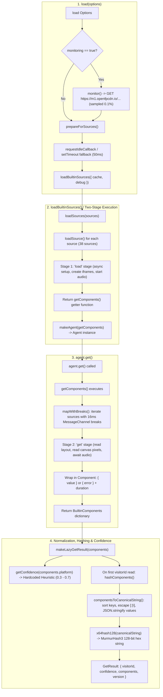

# Research Report: Reverse Engineering FingerprintJS and Evaluating Its Reuse in Bloodtrail

**Document Identity:** `RESEARCH-BT-FPJS-2026-10-12`
**Role:** Principal Security Engineer, Reverse Engineering Specialist, TypeScript SDK Architect, Applied Security Researcher
**Execution Context:** Google Antigravity IDE · REA MCP Integration · Pinned Git Revisions
**Target Projects:**
- **Reference Implementation:** [FingerprintJS v5.3.0](file:///Users/fernando.costa/Git/fingerprintjs) (`dac5ae59409669f09aa09c0b2f44b7615b0520da`)
- **Target Project:** [Bloodtrail main](file:///Users/fernando.costa/Git/bloodtrail) (`e011a710b008fad981fe3804812a425daadc1032`)
- **Prior Research Artifact:** Bloodtrail `research/browser-telemetry` (FingerprintJS v5.2.0 pinned in `package-lock.json`)
- **Reverse Engineering Framework:** REA (Reverse Engineer Anything) MCP Server (Evidence ID: `ev_00201276ae205bda54363e886ffc46996a6f3c39a483a86def8966419eff58b2`)

---

## Executive Summary

This investigation conducted a rigorous, evidence-grounded reverse engineering of **FingerprintJS** (v5.3.0, commit `dac5ae5`) and evaluated whether any of its architectural techniques, algorithms, or signals should be adopted by **Bloodtrail**.

### Key Findings:
1. **Visitor Identifier Nature:** FingerprintJS generates a 128-bit MurmurHash3 hash (`visitorId`) over a canonical concatenation of 38 browser-derived components. This value is **not** a persistent device identity, hardware token, authentication credential, or trustworthy anti-fraud attestation. It is a best-effort, point-in-time environment cluster output that shifts upon browser updates, configuration changes, OS font adjustments, monitor docking, and private browsing modes.
2. **Confidence Score Debunked:** The library's `confidence.score` is **not** an entropy calculation or statistical confidence metric. It is an unverified, hard-coded operating system heuristic (e.g., 0.4 for Android, 0.5 for macOS, 0.6 for Windows) accompanied by marketing comments pointing to commercial Fingerprint Pro upsells (`deriveProConfidenceScore`).
3. **Hidden Outbound Telemetry:** When initialized via `load()`, FingerprintJS defaults `monitoring: true`, executing an asynchronous unpersonalized HTTP GET request via `XMLHttpRequest` to `https://m1.openfpcdn.io/fingerprintjs/v${version}/npm-monitoring` (sampled at 0.1%).
4. **Bloodtrail Governance Alignment:** Bloodtrail's governing project-owner decision on 2026-07-31 concluded **`DEFER BROWSER TELEMETRY — no adoption at this time`** for bot/fraud detection. The subsequently created package `@bloodtrail/client-evidence-browser` (OpenSpec wave `#117–#131`) did **not** rescind that decision; rather, under delegated decision `#117`, it established a strictly bounded scope for **Purpose P1: interaction-scoped audit correlation**. Furthermore, `@bloodtrail/client-evidence-browser/src/constants.ts` explicitly classifies `"fingerprint"`, `"device_id"`, `"hardware"`, `"user_agent"`, `"timezone"`, `"locale"`, and `"screen"` as **`FORBIDDEN_CLAIM_NAMES`**.
5. **Primary Architecture Recommendation:** **Alternative D (No Adoption) with Selective Internal Engineering Guidance**. Bloodtrail must **not** add FingerprintJS as a dependency, nor import its browser signals or identifier generation. Bloodtrail's browser evidence package already fulfills its purpose (P1) with zero third-party dependencies, sub-millisecond execution, and Web Crypto UUID v4 correlation identifiers. However, Bloodtrail's internal SDK design standards can selectively benefit from FingerprintJS's software engineering patterns for error isolation (`{ value, error, duration }`) and non-blocking event-loop yielding (`MessageChannel`).

---

## 1. Context and Research Boundaries (Phase 0)

### 1.1 Checked Repositories and Commit SHAs
- **Target Project (Bloodtrail):**
  - Git Branch: `main`
  - Git Commit SHA: `e011a710b008fad981fe3804812a425daadc1032`
  - Status: Clean working tree (untracked `docs/adversarial-reviews/` preserved).
- **Reference Project (FingerprintJS):**
  - Git Tag: `v5.3.0`
  - Git Commit SHA: `dac5ae59409669f09aa09c0b2f44b7615b0520da`
  - Status: Clean working tree.
- **Historical Comparison (Bloodtrail Research Harness):**
  - Pinned version in `research/browser-telemetry/package-lock.json`: FingerprintJS `v5.2.0`.
  - Upstream delta between `v5.2.0` and `v5.3.0`: Minor maintenance bumps, stricter linting, and commit `e79f0b5` updating Android detection via `Intl.supportedValuesOf('collation')`.

### 1.2 Bloodtrail Governance and Package Audit
A rigorous review of Bloodtrail's documentation and governance history establishes the following structural facts:

| Document / Location | Status & Governance Record | Normative Rule / Finding |
|---|---|---|
| [`research/browser-telemetry/README.md`](file:///Users/fernando.costa/Git/bloodtrail/research/browser-telemetry/README.md) | **DEFER BROWSER TELEMETRY** (2026-07-31) | Project-owner decision: No adoption for detection/enforcement. Browser reported data is attacker-controlled, suppressible, spoofable, and replayable. Missing telemetry is not abuse evidence. |
| [`research/browser-telemetry/source-evidence.md`](file:///Users/fernando.costa/Git/bloodtrail/research/browser-telemetry/source-evidence.md) | Immutable PoC baseline (`baseline-2026-07-30.sanitized.json`) | Empirical finding: FingerprintJS produced unstable visitorIds (2 distinct hashes) under 6x CPU throttling. BotD was bypassed with simple prototype mocks. FingerprintJS ESM is 129 KB raw / 37.5 KB gzip. |
| [`openspec/changes/archive/2026-09-11-add-client-evidence-capability/decisions/117-client-evidence-purpose.md`](file:///Users/fernando.costa/Git/bloodtrail/openspec/changes/archive/2026-09-11-add-client-evidence-capability/decisions/117-client-evidence-purpose.md) | Delegated Decision `#117` | **GO for one purpose only: Purpose P1 (interaction-scoped audit correlation)**. Supersedes 2026-07-31 detection criteria for P1 only; leaves no-adoption decision standing for detection/anti-fraud. |
| [`openspec/changes/archive/2026-09-11-add-client-evidence-capability/decisions/129-mode-b-device-trust.md`](file:///Users/fernando.costa/Git/bloodtrail/openspec/changes/archive/2026-09-11-add-client-evidence-capability/decisions/129-mode-b-device-trust.md) | Delegated Decision `#129` | **NO-GO for Mode B Device Trust**. Concludes that device attestation cannot raise audit grouping accuracy above 1.0; closed issue `#130` without implementation. |
| [`packages/client-evidence-browser/src/constants.ts`](file:///Users/fernando.costa/Git/bloodtrail/packages/client-evidence-browser/src/constants.ts#L13-L39) | Ratified Code Bounds | **`FORBIDDEN_CLAIM_NAMES`** strictly proscribes `"fingerprint"`, `"device_id"`, `"hardware"`, `"user_agent"`, `"timezone"`, `"locale"`, `"screen"`, `"location"`, `"ip"`, `"cookie"`, `"auth_token"`. |
| [`contracts/security-audit/source/contract.source.json`](file:///Users/fernando.costa/Git/bloodtrail/contracts/security-audit/source/contract.source.json#L2029-L2124) | Authoritative Audit Contract 2.1.0 (`ADR-009`) | Canonical envelope reference: only `interaction_id` (UUID v4), `interaction_kind`, `envelope_version: 1`, and fixed provenance (`client_reported`, `client_claim`, `web_browser`, `interaction_ephemeral`). Category: `claimed_identity`. Enforcement: **"never sole evidence"**. |

### 1.3 Resolution of the Three Core Questions
1. **What engineering principles from FingerprintJS are valuable?**
   - Structural error containment (`loadSource` capturing `{ value, error, duration }` so no individual failure halts execution).
   - Microtask drift mitigation (`awaitIfAsync` avoiding unnecessary Promise microtasks for synchronous operations).
   - Event-loop slicing (`mapWithBreaks` yielding execution every 16ms using `MessageChannel` rather than throttled `setTimeout`).
2. **What, if anything, could improve Bloodtrail's existing browser evidence architecture?**
   - `@bloodtrail/client-evidence-browser` is already purpose-built for P1: it operates synchronously in <0.1ms, produces a clean UUID v4 envelope, has zero dependencies, and creates zero DOM mutations or reflows. Adding heavy browser environment probing would degrade performance and violate its P1 data-minimization contract.
3. **What new functionality would require separate governance, privacy review, and explicit authorization?**
   - Any collection of environmental hardware, canvas, audio, or client hints.
   - Any persistent identifier generation.
   - Any removal of items from `FORBIDDEN_CLAIM_NAMES`.
   - Any real-user deployment (still blocked under governance pending qualified legal/privacy review under GDPR/ePrivacy/LGPD).

---

## 2. REA Integration and Tooling Verification (Phase 1)

REA (Reverse Engineer Anything) was verified through the Antigravity MCP integration.
- **Tooling Readiness:** REA MCP server was active, responsive, and inspected using lazy-loaded MCP tools `binary_session` and `analyze_javascript_application`.
- **Target Analysis:**
  - Artifact path: `/Users/fernando.costa/Git/bloodtrail/research/browser-telemetry/node_modules/@fingerprintjs/fingerprintjs`
  - Shipped Artifact Digest: SHA-256 `0f82694cd2090a0d5c9bdca216862a24b9835d9f6245892b10d8386c4ff27ce4`
  - Parent Evidence ID: `ev_00201276ae205bda54363e886ffc46996a6f3c39a483a86def8966419eff58b2`
  - Analysis Profile: `analyze_javascript_application` (detail: `summary`)
- **REA Module Graph Findings:**
  - Recovered module nodes across `dist/fp.esm.js`, `dist/fp.min.js`, `dist/fp.cjs.js`, `dist/fp.umd.js`.
  - Verified package exports match declared Rollup output shapes without hidden binary sidecars or native Node add-ons.
  - REA confirmed 25 internal timer relations, boundary parse coercions, and absence of child-process or native bindings, validating that FingerprintJS is purely JavaScript targeting browser runtimes.

---

## 3. Reverse Engineering FingerprintJS (Phase 2)

### 3.1 Architecture & Full Execution Path



#### Detailed Execution Walkthrough:
1. **Entry Point ([`src/index.ts:1-23`](file:///Users/fingerprintjs/src/index.ts#L1-L23)):**
   - The library exports `load()`, `hashComponents()`, `componentsToDebugString()`, and internal helpers.
2. **Initialization & Telemetry ([`src/agent.ts:182-212`](file:///Users/fernando.costa/Git/fingerprintjs/src/agent.ts#L182-L212)):**
   - `load(options)` accepts `delayFallback` (default 50ms), `debug`, and `monitoring` (default `true`).
   - If `monitoring === true`, `monitor()` executes: if `window.__fpjs_d_m` is falsy and `Math.random() < 0.001`, an asynchronous `XMLHttpRequest` GET is dispatched to `https://m1.openfpcdn.io/fingerprintjs/v${version}/npm-monitoring`.
   - `prepareForSources()` calls `requestIdleCallbackIfAvailable(50, 100)` to ensure browser layout and idle state stabilize.
3. **Two-Stage Source Architecture ([`src/utils/entropy_source.ts:62-113`](file:///Users/fingerprintjs/src/utils/entropy_source.ts#L62-L113)):**
   - Entropy sources implement `Source<TOptions, TValue> = (options) => MaybePromise<TValue | (() => MaybePromise<TValue>)>`.
   - **Stage 1 (Load):** Asynchronous setup is initiated immediately during `loadSources()` (e.g., creating hidden iframes in DOM, starting audio context oscillator rendering, setting up canvas elements).
   - **Stage 2 (Get):** When `agent.get()` is invoked, the returned finalize closures are evaluated to harvest measurements (reading rendered bounding boxes, extracting audio buffer channel data).
4. **Error Containment & Timing Isolation ([`src/utils/entropy_source.ts:72-105`](file:///Users/fernando.costa/Git/fingerprintjs/src/utils/entropy_source.ts#L72-L105)):**
   - Errors in individual collectors are caught via `awaitIfAsync` and packaged as `{ error: err, duration: ms }`. No individual failure crashes the collector pipeline.
   - `awaitIfAsync` ([`src/utils/async.ts:51-68`](file:///Users/fernando.costa/Git/fingerprintjs/src/utils/async.ts#L51-L68)) ensures synchronous collectors do not create unnecessary Promise microtasks, preventing timing measurement skew.
5. **Non-Blocking Scheduling ([`src/utils/async.ts:75-94`](file:///Users/fernando.costa/Git/fingerprintjs/src/utils/async.ts#L75-L94)):**
   - `mapWithBreaks` processes collectors in chunks. Every 16ms (one 60Hz frame budget), it yields the JavaScript thread using `releaseEventLoop()`, which dispatches a message via `new MessageChannel()` rather than `setTimeout` (to bypass background tab throttling in Chromium).
6. **Shared State and Ordering Constraints ([`src/sources/index.ts:59-107`](file:///Users/fernando.costa/Git/fingerprintjs/src/sources/index.ts#L59-L107)):**
   - Asynchronous sources (`userAgentData`, `fonts`, `domBlockers`, `fontPreferences`, `audio`, `screenFrame`) run first to overlap I/O and rendering.
   - Synchronous sources execute sequentially.
   - `webGlBasics` and `webGlExtensions` run last because creating a WebGL context is known to alter canvas state and GPU rendering contexts in certain drivers.
   - Shared module caching: `cache.webgl = { context }` avoids redundant context recreation.

---

### 3.2 Comprehensive Browser Signals Taxonomy (38 Sources)

Below is the verified inventory of all 38 entropy sources in FingerprintJS v5.3.0:

| Source Name | Collection Mechanism & API | Information Content / Purpose | Cross-Session Stability | Update / Config Sensitivity | Privacy & Identifiability | Performance Cost | Spoofing Resistance |
|---|---|---|---|---|---|---|---|
| `userAgentData` | `navigator.userAgentData.getHighEntropyValues` | Client Hints (brands, platform, arch, bitness) | High | High (browser version bump) | High (device model/platform) | Async (~5–20ms) | Low (trivial prototype mock) |
| `fonts` | Invisible `<iframe>` with 68 test fonts vs 3 base fonts | Installed local/system fonts via layout reflow | High | High (installing/removing fonts) | High (font fingerprinting) | High (~30–80ms DOM reflow) | Low (override `offsetWidth`) |
| `domBlockers` | Injecting DOM elements matching ad-block rules | Ad-blocker & privacy extension presence | Medium | High (filter list updates) | Medium (extension profiling) | Medium (DOM mutations) | Low (blocker evasion) |
| `fontPreferences` | Measuring system default font metrics | Default system text sizing / DPI | High | Low | Low | Medium (DOM reflow) | Low |
| `audio` | `OfflineAudioContext` (10kHz oscillator + compressor) | Audio stack & floating point math | Medium | High (anti-fingerprint noise) | Medium | High (~50–200ms) | Medium (skips Safari 17+) |
| `screenFrame` | `screen.availTop/Left/Width/Height` | Usable display geometry outside taskbar | Medium | High (dock changes, monitors) | Medium | Low (watches interval) | Low (`exitFullscreen()` side effect) |
| `canvas` | 2D Canvas rendering (winding, geometry, text) | GPU rasterization & font rendering quirks | Low–Medium | High (noise in Safari 17/FF 120+) | High | Medium (~10–30ms) | Low (skips Safari 17/FF 120+) |
| `osCpu` | `navigator.oscpu` | Operating system and CPU type | High | Low | Medium | Negligible | Low (trivial property mock) |
| `languages` | `navigator.languages`, `navigator.language` | Configured user languages | High | Medium (user settings) | Medium | Negligible | Low |
| `colorDepth` | `screen.colorDepth` | Display bit depth | High | Low | Low | Negligible | Low |
| `deviceMemory` | `navigator.deviceMemory` | Approximate RAM in GiB | High | Low | Low (coarse bucketed) | Negligible | Low |
| `screenResolution`| `screen.width`, `screen.height` | Physical screen resolution | Medium | High (display scaling/monitors) | Medium | Negligible | Low |
| `hardwareConcurrency`| `navigator.hardwareConcurrency` | Logical CPU core count | High | Low (spoofed in FF 143+ strict) | Low | Negligible | Low (mirrors FF 143+ tiering) |
| `timezone` | `Intl.DateTimeFormat().resolvedOptions().timeZone` | IANA Timezone string | Medium | High (travel/VPN/time change) | High (geographic location) | Negligible | Low |
| `sessionStorage` | `'sessionStorage' in window` | Storage API availability | High | Low | Low | Negligible | Low |
| `localStorage` | `'localStorage' in window` | Storage API availability | High | Low | Low | Negligible | Low |
| `indexedDB` | `'indexedDB' in window` | IndexedDB availability | High | Low | Low | Negligible | Low |
| `openDatabase` | `'openDatabase' in window` | WebSQL availability (legacy) | High | High (removed in modern Chrome) | Low | Negligible | Low |
| `cpuClass` | `navigator.cpuClass` | Legacy IE CPU class | High | Obsolete | Low | Negligible | Low |
| `platform` | `navigator.platform` | System architecture platform string | High | Low | Medium | Negligible | Low |
| `plugins` | `navigator.plugins` array | Browser plugins (PDF viewer in modern) | High | Static in modern Chromium/FF | Low (homogenized) | Negligible | Low |
| `touchSupport` | `navigator.maxTouchPoints`, `TouchEvent` | Touchscreen availability | High | Low | Low | Negligible | Low |
| `vendor` | `navigator.vendor` | Browser vendor string | High | Low | Low | Negligible | Low |
| `vendorFlavors` | Browser-specific globals (`chrome`, `safari`) | Specific browser brand detection | High | Low | Low | Negligible | Low |
| `cookiesEnabled` | `navigator.cookieEnabled` | Cookie support | High | Low | Low | Negligible | Low |
| `colorGamut` | `window.matchMedia('(color-gamut: srgb/p3/rec2020)')` | Wide color gamut support | High | Low | Low | Negligible | Low |
| `invertedColors` | `matchMedia('(inverted-colors: inverted)')` | Accessibility color inversion | High | Low | Low | Negligible | Low |
| `forcedColors` | `matchMedia('(forced-colors: active)')` | High contrast accessibility mode | High | Low | Low | Negligible | Low |
| `monochrome` | `matchMedia('(monochrome)')` | Grayscale display detection | High | Low | Low | Negligible | Low |
| `contrast` | `matchMedia('(prefers-contrast: more/less)')` | User contrast preference | High | Low | Low | Negligible | Low |
| `reducedMotion` | `matchMedia('(prefers-reduced-motion: reduce)')`| Reduced motion accessibility | High | Low | Low | Negligible | Low |
| `reducedTransparency`| `matchMedia('(prefers-reduced-transparency: reduce)')`| Reduced transparency preference | High | Low | Low | Negligible | Low |
| `hdr` | `matchMedia('(dynamic-range: high)')` | High dynamic range display | High | Low | Low | Negligible | Low |
| `math` | Transcendental math functions (`acos`, `sin`, etc.) | IEEE 754 precision LSB differences | High | High (compiler/libm changes) | Medium | Low (~1ms) | Low |
| `pdfViewerEnabled`| `navigator.pdfViewerEnabled` | PDF viewer status | High | Low | Low | Negligible | Low |
| `architecture` | `Infinity - Infinity` NaN sign bit | CPU ISA (x86 sign bit vs ARM) | High | Low | Medium | Negligible | Low |
| `applePay` | `window.ApplePaySession` | Apple Pay capability | High | Low (Apple devices only) | Medium | Negligible | Low |
| `privateClickMeasurement`| `HTMLAnchorElement.prototype.attributionSourceId` | WebKit PCM support | High | Low | Low | Negligible | Low |
| `audioBaseLatency`| `AudioContext.prototype.baseLatency` | Audio hardware buffer latency | Medium | High (audio devices) | Low | Negligible | Low |
| `dateTimeLocale` | `Intl.DateTimeFormat().resolvedOptions().locale` | Browser locale formatting | High | High (user language changes) | High (demographic/geographic) | Negligible | Low |
| `webGlBasics` | `WebGLRenderingContext` parameters | GPU vendor, renderer, GL version | High | High (driver/GPU switching) | High (unmasked GPU model) | Medium (~10–30ms) | Low |
| `webGlExtensions` | WebGL extensions & shader precisions | GPU feature capabilities | High | High (driver updates) | High | Medium (~10–20ms) | Low |

---

### 3.3 Fingerprint Calculation & Hashing Analysis

#### Canonical Serialization ([`src/agent.ts:82-90`](file:///Users/fernando.costa/Git/fingerprintjs/src/agent.ts#L82-L90))
Components are converted to a single canonical string:
```ts
function componentsToCanonicalString(components: UnknownComponents) {
  let result = ''
  for (const componentKey of Object.keys(components).sort()) {
    const component = components[componentKey]
    const value = 'error' in component ? 'error' : JSON.stringify(component.value)
    result += `${result ? '|' : ''}${componentKey.replace(/([:|\\])/g, '\\$1')}:${value}`
  }
  return result
}
```
- **Sorting:** Keys are strictly sorted lexicographically (`Object.keys().sort()`).
- **Escaping:** Delimiters `:`, `|`, and `\` are backslash-escaped.
- **Value Handling:** If an error occurred, the literal string `'error'` is recorded. Otherwise, values are formatted via `JSON.stringify()`.
- **Delimiter:** Pipe (`|`) separates components, colon (`:`) separates key and value.

#### Hashing Function ([`src/utils/hashing.ts:163-301`](file:///Users/fernando.costa/Git/fingerprintjs/src/utils/hashing.ts#L163-L301))
- **Algorithm:** MurmurHash3 x64 128-bit (`x64hash128`).
- **Input:** UTF-8 byte stream derived from the canonical string.
- **Output:** 32-character lowercase hexadecimal string representing four 32-bit integer blocks `[h1[0], h1[1], h2[0], h2[1]]`.
- **Security & Collision Properties:**
  - MurmurHash3 is a **non-cryptographic hash function**. It is designed solely for rapid hash table distribution.
  - It possesses **zero cryptographic collision resistance** and **zero preimage resistance**.
  - Standard collision generation and seed-independent multi-collision attacks are trivial against MurmurHash3.
  - The algorithm avalanche effect ensures that if even a single bit of input changes (e.g. an updated font, a minor Chrome version bump, or a browser setting toggle), the resulting 128-bit hash completely changes.
  - In homogeneous environments (e.g. enterprise fleets with identical laptops, OS images, and browsers), different physical machines produce **identical visitorIds**.

#### Deconstruction of the Confidence Score ([`src/confidence.ts:20-65`](file:///Users/fernando.costa/Git/fingerprintjs/src/confidence.ts#L20-L65))
FingerprintJS exposes a `confidence: { score, comment }` property. Analysis reveals:
```ts
function getOpenConfidenceScore(components: Pick<BuiltinComponents, 'platform'>): number {
  if (isAndroid()) return 0.4
  if (isWebKit()) return isDesktopWebKit() && !(isWebKit616OrNewer() && isSafariWebKit()) ? 0.5 : 0.3
  const platform = 'value' in components.platform ? components.platform.value : ''
  if (/^Win/.test(platform)) return 0.6
  if (/^Mac/.test(platform)) return 0.5
  return 0.7 // Desktop Linux
}
```
- The score is an **unsubstantiated static lookup table** based strictly on user-agent / platform strings.
- It does not calculate mathematical entropy, uniqueness, or collision probability.
- Furthermore, `deriveProConfidenceScore` ([`src/confidence.ts:63-65`](file:///Users/fernando.costa/Git/fingerprintjs/src/confidence.ts#L63-L65)) computes `0.99 + 0.01 * openScore` and returns an upsell comment: `"$ if upgrade to Pro: https://fingerprint.com/github/..."`.
- **Conclusion:** The confidence score has **no cryptographic or security value**.

---

### 3.4 Privacy, Network Egress & Supply Chain

1. **Third-Party Network Egress ([`src/agent.ts:185-199`](file:///Users/fernando.costa/Git/fingerprintjs/src/agent.ts#L185-L199)):**
   - In open-source npm builds, `load()` defaults `monitoring: true`.
   - Dispatches unpersonalized GET requests to `https://m1.openfpcdn.io/fingerprintjs/v${version}/npm-monitoring` at a 0.1% sampling rate.
   - For isolated, privacy-compliant testing, `monitoring: false` **must** be explicitly provided.
2. **DOM and UX Side Effects:**
   - Injects hidden `<iframe>` elements to test fonts ([`src/utils/dom.ts:14-85`](file:///Users/fernando.costa/Git/fingerprintjs/src/utils/dom.ts#L14-L85)).
   - Injects hundreds of hidden ad-block filter elements into `document.body` ([`src/sources/dom_blockers.ts`](file:///Users/fernando.costa/Git/fingerprintjs/src/sources/dom_blockers.ts)).
   - Calls `document.exitFullscreen()` to reset screen frames if fullscreen is active ([`src/sources/screen_frame.ts:77-83`](file:///Users/fernando.costa/Git/fingerprintjs/src/sources/screen_frame.ts#L77-L83)).
3. **Supply Chain & Dependencies:**
   - Upstream License: MIT.
   - Runtime Dependencies: **Zero** external runtime dependencies.
   - Build Tools: Rollup, Terser, TypeScript 5.

---

## 4. Bloodtrail Architecture vs FingerprintJS (Phases 4 & 5)

### 4.1 Comparative Architectural Mapping

| Dimension | FingerprintJS (v5.3.0) | Bloodtrail (`@bloodtrail/client-evidence-browser`) | Architectural Evaluation |
|---|---|---|---|
| **Primary Purpose** | Cross-session visitor tracking, environment hashing | Interaction-scoped audit correlation (P1) | **Fundamentally Divergent**: Bloodtrail's purpose is correlating server events to client interactions, not identifying devices. |
| **Identifier Semantics** | MurmurHash3 128-bit hash of 38 environment signals | Cryptographically random UUID v4 (`Web Cryptography API`) | **FingerprintJS Incompatible**: UUID v4 provides collision-free interaction scoping without probing user hardware. |
| **Trust Model** | Claimed "device fingerprint" (unverified client output) | Explicitly bounded `client_claim` trust floor | **Identical Reality**: Both are client-controlled and easily forged. Bloodtrail explicitly treats it as low-assurance. |
| **Privacy / Prohibited Data** | Harvests hardware, screen, fonts, timezone, locale | Enforces `FORBIDDEN_CLAIM_NAMES` (bans fingerprint, hardware, screen, etc.) | **Direct Violation**: Adopting FingerprintJS signals directly violates Bloodtrail's ratified privacy rules. |
| **Storage & Persistence** | Probes localStorage/indexedDB, derives persistent hash | Zero storage (`no localStorage, no cookies, no indexedDB`) | **Bloodtrail Compliant**: Bloodtrail strictly forbids client-side persistence for P1. |
| **Network Egress** | Defaults `monitoring: true` (`m1.openfpcdn.io`) | Zero network egress (`no transport in client package`) | **FingerprintJS Dangerous**: Automatic egress violates security SDK transport isolation. |
| **Dependencies** | Zero runtime dependencies | Zero runtime dependencies (zero Node built-ins, zero Core) | Both maintain zero third-party runtime dependencies. |
| **Runtime Latency** | ~50ms to >250ms (DOM reflows, audio context, WebGL) | <0.1ms (synchronous Web Crypto UUID generation) | **FingerprintJS Degrading**: Running FingerprintJS would introduce significant CPU overhead and layout thrashing. |
| **Bundle Size Impact** | 129 KB raw / 37.5 KB gzip (minified: 36.7 KB / 16.2 KB) | ~4 KB raw / <1.5 KB gzip | **FingerprintJS Overhead**: ~10x bundle size inflation. |
| **Audit Contract Alignment** | None (`visitorId` is not part of audit contract 2.1.0) | Strictly satisfies `ADR-009` and schema 2.1.0 reference | **Bloodtrail Native**: Fully mapped and validated by collector ingress. |

---

### 4.2 Gap-Analysis and Reuse Classification

| Technique / Component | Bloodtrail Equivalent | Gap / Problem Solved | Fit for Bloodtrail | Governance Status | Recommendation |
|---|---|---|---|---|---|
| **Visitor Identifier (`visitorId`)** | UUID v4 `interaction_id` | Solves cross-session device tracking (unneeded for P1) | Incompatible with P1 audit correlation | Prohibited by `FORBIDDEN_CLAIM_NAMES` | **REJECT** |
| **Browser Signal Probing (38 sources)** | None (intentionally excluded) | Gathers device entropy for fingerprinting | Violates privacy minimization & contract bounds | Prohibited by `FORBIDDEN_CLAIM_NAMES` | **REJECT** |
| **`confidence.score` Algorithm** | None | Marketing heuristic; zero security value | Zero architectural fit | N/A | **REJECT** |
| **Outbound Telemetry (`monitor()`)** | None | Sends installation metrics to third-party CDN | Prohibited in enterprise security SDKs | Forbidden by transport boundary | **REJECT** |
| **Error Containment (`{ value, error, duration }`)** | Standard try/catch in SDK Core | Prevents collector crashes, isolates component metrics | Good software design practice | Allowed for internal SDK refactoring | **ADAPT** (as engineering pattern) |
| **Event Loop Yielding (`MessageChannel`)** | None in browser package (synchronous execution) | Prevents UI freezing during long-running tasks | Useful if Bloodtrail ever needs heavy client hashing | Allowed if needed in future work | **ADAPT** (as engineering pattern) |
| **Canonical Sorting (`Object.keys().sort()`)** | Contract canonical JSON serialization | Deterministic ordering for hashing | Already solved in SDK Core canonicalization | Core feature | **ALREADY COVERED** |
| **Interaction-Scoped Envelope** | `ClientEvidenceEnvelope` v1 | Interaction correlation without tracking | Perfect fit for P1 | Ratified in OpenSpec `#123` | **ALREADY COVERED** |

---

## 5. Security & Threat Modeling (Phase 6)

### 5.1 Adversarial Capabilities in Browser Contexts
When evaluating browser-derived telemetry, the threat model must assume an untrusted environment:
1. **JavaScript Runtime Manipulation:**
   - Attackers using Puppeteer, Playwright, Selenium, or anti-detect browsers (e.g., Multilogin, GoLogin) can effortlessly monkey-patch `Object.defineProperty`, `navigator`, `HTMLCanvasElement.prototype.toDataURL`, and `OfflineAudioContext.prototype.startRendering`.
   - As proven in Bloodtrail's baseline tests ([`source-evidence.md:POC-RESULT`](file:///Users/fernando.costa/Git/bloodtrail/research/browser-telemetry/source-evidence.md)), simple property overrides completely bypass bot detection and spoof fingerprint components.
2. **Replay and Fabrication:**
   - Any client-generated envelope can be replayed or synthesized by malicious HTTP clients (e.g., `curl`, Python `requests`).
   - Adding cryptographic hashes over browser parameters does not prevent an attacker from computing and transmitting valid hashes over fabricated parameters.
3. **Environment Instability and Collisions:**
   - Legitimate privacy defenses (Safari Private Browsing, Firefox Strict Tracking Protection, Brave Shields) inject random noise into canvas and audio outputs or tier hardware concurrency, causing fingerprints to churn across requests.
   - Large enterprise organizations deploying standardized desktop images share identical hardware, OS versions, graphics cards, and browsers, causing widespread fingerprint collisions.

### 5.2 Separation of Concerns
Security architecture requires maintaining rigid separation across conceptual categories:

```
┌────────────────────────────────────────────────────────────────────────┐
│                   BLOODTRAIL TRUST BOUNDARY TAXONOMY                   │
├──────────────────────────┬─────────────────────────────────────────────┤
│ Level                    │ Semantics & Security Implications           │
├──────────────────────────┼─────────────────────────────────────────────┤
│ Correlation Evidence     │ Bounded UUID v4 interaction reference       │
│ (client_claim)           │ - Groups server events to client actions    │
│                          │ - Attacker-controlled; never proof of truth │
├──────────────────────────┼─────────────────────────────────────────────┤
│ Environmental Telemetry  │ Browser signals (canvas, audio, UA)         │
│ (NOT AUTHORIZED)         │ - Easily spoofed, privacy-invasive          │
│                          │ - High false positives; zero attestation    │
├──────────────────────────┼─────────────────────────────────────────────┤
│ Verified Authority       │ Server-side cryptographic signatures / HMAC │
│ (derived_server)         │ - Proves possession of server keys          │
│                          │ - Authoritative audit integrity             │
├──────────────────────────┼─────────────────────────────────────────────┤
│ Authentication Evidence  │ WebAuthn / Passkeys / Mutual TLS            │
│ (hardware_attestation)   │ - Cryptographic proof of identity           │
│                          │ - Independent of browser environment        │
└──────────────────────────┴─────────────────────────────────────────────┘
```

### 5.3 Legal and Privacy Compliance
- **GDPR (Articles 4(1), 5(1)(c), 6, 25):** Device fingerprints that persist or distinguish individuals are classified as online identifiers and personal data. Processing requires a valid lawful basis (often consent under ePrivacy Article 5(3)) and adherence to data minimization.
- **ePrivacy Directive (Article 5(3)) & EDPB Guidelines 2/2023:** Accessing or storing information in user terminal equipment (such as querying screen dimensions, canvas pixels, or hardware concurrency for tracking) requires prior user consent unless strictly necessary for a service explicitly requested by the user.
- **LGPD & CCPA:** Similar requirements apply regarding unique identifiers and behavioral profiling.
- **Bloodtrail Status:** `@bloodtrail/client-evidence-browser` produces an ephemeral UUID v4 for the single interaction without terminal equipment profiling, maintaining compliance with privacy-by-design standards.

---

## 6. Architectural Alternatives & Recommendation (Phases 7 & 8)

### 6.1 Evaluation of Alternatives

#### Alternative A: Direct Dependency (`@fingerprintjs/fingerprintjs`)
- **Action:** Add `@fingerprintjs/fingerprintjs` to `@bloodtrail/client-evidence-browser` and include `visitorId` in the client evidence envelope.
- **Pros:** Out-of-the-box maintenance of browser compatibility workarounds.
- **Cons:** Violates project-owner decision `DEFER BROWSER TELEMETRY`; violates `FORBIDDEN_CLAIM_NAMES`; introduces 37.5 KB gzip bundle overhead; adds unvetted outbound network telemetry (`m1.openfpcdn.io`); degrades browser interaction performance; creates legal liability under GDPR/ePrivacy.
- **Verdict:** **REJECT**.

#### Alternative B: Selective Adaptation of Fingerprinting Signals
- **Action:** Re-implement a subset of high-entropy signals (e.g. Canvas, Audio, WebGL) as first-party Bloodtrail code.
- **Pros:** Avoids third-party telemetry and dependencies.
- **Cons:** Still violates Bloodtrail's privacy minimization bounds; requires continuous cross-browser maintenance against browser anti-fingerprinting defenses; provides zero cryptographic attestation; remains easily spoofed by motivated adversaries.
- **Verdict:** **REJECT**.

#### Alternative C: Minimal Independent Environmental Collector
- **Action:** Create a tiny, privacy-preserving client sensor capturing coarse diagnostic data (e.g. screen orientation, platform family).
- **Pros:** Minimal size impact.
- **Cons:** Unnecessary for Purpose P1 (audit correlation). Does not improve interaction correlation accuracy (which already achieved 1.0 in Mode A PoC testing using UUID v4). Requires a separate OpenSpec proposal and privacy review.
- **Verdict:** **DEFER / RESEARCH ONLY**.

#### Alternative D: No Adoption (Reference Material Only) — **RECOMMENDED**
- **Action:** Maintain FingerprintJS strictly as educational and reference material. Preserve Bloodtrail's current architecture:
  - `@bloodtrail/client-evidence-browser` continues generating UUID v4 interaction IDs via Web Cryptography API.
  - Zero runtime dependencies, zero transport, zero storage.
  - Audit Contract 2.1.0 retains `client_evidence` as an interaction reference floored at `client_claim`.
  - Apply FingerprintJS's code quality lessons (e.g. robust error wrapping and event loop yielding) to future internal SDK core refactoring where applicable.
- **Pros:** 100% compliant with existing governance; zero performance penalty; zero privacy risk; zero bundle size bloat; perfectly maintains existing OpenSpec boundaries.
- **Verdict:** **RECOMMENDED**.

---

### 6.2 Phased Roadmap and Governance Requirements

If any team or stakeholder ever requests revisiting browser environmental telemetry in the future, the following strict governance prerequisites must be met before writing any production code:

1. **Step 1: OpenSpec Governance Proposal (`RFC / Change Request`):**
   - Must draft a formal OpenSpec proposal (e.g. `continue-browser-telemetry-poc`).
   - Must define falsifiable utility metrics proving measurable incremental security lift against sophisticated attackers, beyond server-side Redis correlation.
2. **Step 2: Qualified Legal & Privacy Review:**
   - Formal DPIA (Data Protection Impact Assessment) under GDPR Art. 35 and ePrivacy Art. 5(3).
   - Approval of consent mechanisms and user disclosures.
3. **Step 3: Contract Modification Change Management:**
   - Modification of authoritative `contracts/security-audit/source/contract.source.json` via approved OpenSpec change.
   - Lifting or modifying `FORBIDDEN_CLAIM_NAMES` with explicit security review.
4. **Step 4: Fail-Open & Egress Enforcement:**
   - Automated CI tests verifying zero outbound network egress.
   - Guaranteeing that missing or failed telemetry never blocks or degrades legitimate user experiences.

---

## 7. Open Questions & Technical Limits

1. **Longitudinal Fleet Stability:** Local testing demonstrates that 6x CPU throttling and private browsing cause visitorId drift. However, true population-level collision rates and stability across millions of mobile devices can only be measured with large-scale labeled datasets, which Bloodtrail intentionally does not collect.
2. **Browser Engine Evolution:** Major browser vendors (Apple WebKit, Mozilla Gecko, Google Chromium) are actively implementing Privacy Sandbox and Anti-Fingerprinting protections (e.g. WebKit Private Browsing protections, Firefox RFP, Chromium User-Agent reduction). Any client-side fingerprinting library faces diminishing utility and increasing maintenance costs over time.
3. **Future Native Attestation (Mode B):** While Mode B device trust was concluded NO-GO for P1, future non-browser native clients (e.g. iOS App Attest, Android Play Integrity) could theoretically provide hardware-backed claims if a separate high-assurance use case is ever authorized by the project owner.

---

## Conclusion

FingerprintJS is a well-crafted, sophisticated browser environment hashing library for its intended commercial use case. However, its methods and objectives are fundamentally misaligned with Bloodtrail's security audit architecture, privacy bounds, and governance mandates. Bloodtrail's current `@bloodtrail/client-evidence-browser` implementation correctly solves interaction-scoped audit correlation (P1) without tracking users, without third-party dependencies, and without compromising performance.
