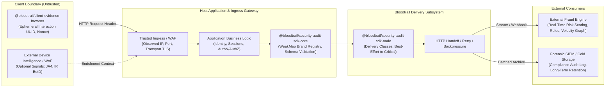
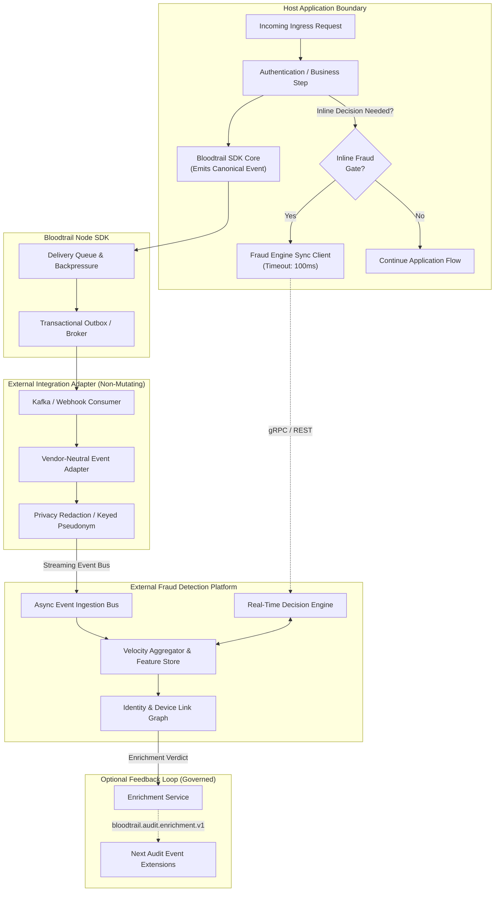
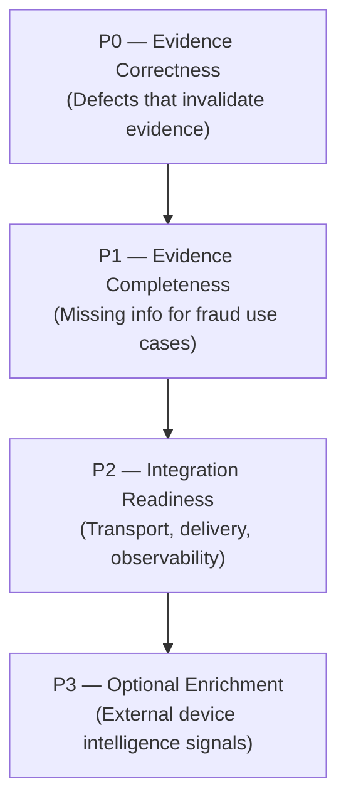

# Bloodtrail — Fraud Evidence Collection Readiness Assessment

**Document Identity:** `ASSESSMENT-BT-FRAUD-READINESS-2026-10-12`
**Evaluation Target Repositories:**
- **Bloodtrail:** `https://github.com/nandohdc/bloodtrail` (Pinned Commit `3db5b02b5e0c5b3c5e88456a65ba186eb9b2df15`, Branch `main`)
- **FingerprintJS OSS:** `https://github.com/fingerprintjs/fingerprintjs` (Pinned Tag `v5.3.0`, Commit `dac5ae59409669f09aa09c0b2f44b7615b0520da`)
- **REA Static Analysis Baseline:** Evidence `ev_0245673b7609e4ca652a16649a07a82e148b45b26f8a625e213359b3d5e02fec` (`eb28fb5e9b6e3528a3965b3ea310580aafb59bb63aacdc523e3e17d64360cc54`)
**Evaluator Roles:** Principal Security Architect, Fraud Intelligence Engineer, TypeScript SDK Architect, and Reverse Engineering Specialist
**Date:** 2026-10-12
**Status:** Complete / Evidence-Driven / Read-Only Assessment

---

## Executive Summary & Core Verdict

This assessment evaluates whether **Bloodtrail** is a sufficiently capable, secure, reliable, and extensible evidence-collection SDK for feeding **external fraud detection engines**.

> [!IMPORTANT]
> **Architectural Non-Goal:** Bloodtrail is **not** a fraud detection engine, risk decision platform, or behavioral enforcement system. It does not compute fraud scores, train machine learning models, or execute automated account blocks. Its sole mandate is to capture, validate, standardize, correlate, and deliver high-integrity security and operational evidence across application boundaries while strictly enforcing source provenance and privacy bounds.

### Primary Architectural Verdict

**Bloodtrail is an outstanding, mathematically disciplined foundation for collecting server-authoritative security, authentication, authorization, session, and administrative fraud evidence.** Its provenance-tagging architecture, fail-closed contract validation, unforgeable context branding, and strict trust floors establish a level of adversarial evidence integrity rarely achieved in commercial SDKs.

However, **Bloodtrail is currently incomplete as an end-to-end evidence pipeline for e-commerce, transaction, payment, and advanced bot fraud**, due to three concrete architectural and governance boundaries:

1. **Strictly Security-Audit Scoped Event Catalog:** Bloodtrail’s canonical catalog ([`contracts/security-audit/catalog/catalog.json`](https://github.com/nandohdc/bloodtrail/blob/3db5b02b5e0c5b3c5e88456a65ba186eb9b2df15/contracts/security-audit/catalog/catalog.json)) defines exactly 24 events focused exclusively on identity, access, configuration, data governance, and multi-tenancy. It contains **zero** event definitions for payments, refunds, shopping cart modifications, checkout attempts, or monetary transfers. Because schema validation is closed (`additionalProperties: false`), an application cannot emit business transaction events under the current canonical contract.
2. **Interaction-Ephemeral Client Evidence Boundary:** The browser telemetry package ([`@bloodtrail/client-evidence-browser`](https://github.com/nandohdc/bloodtrail/tree/3db5b02b5e0c5b3c5e88456a65ba186eb9b2df15/packages/client-evidence-browser)) operates within non-production synthetic bounds governed by AI-delegated Decision `#117`. It provides ephemeral UUIDv4 interaction correlation and echoes a single-use server nonce, while explicitly proscribing 24 browser and device properties (`FORBIDDEN_CLAIM_NAMES`). It collects no device intelligence, bot heuristics, or network environment signals.
3. **Multi-Tenant Isolation vs. Fraud Graph Synthesis:** Bloodtrail enforces strict tenant isolation and proscribes cross-tenant correlation by default ([`contracts/security-audit/adr/adr-006.md`](https://github.com/nandohdc/bloodtrail/blob/3db5b02b5e0c5b3c5e88456a65ba186eb9b2df15/contracts/security-audit/adr/adr-006.md), [`adr-007.md`](https://github.com/nandohdc/bloodtrail/blob/3db5b02b5e0c5b3c5e88456a65ba186eb9b2df15/contracts/security-audit/adr/adr-007.md)). External fraud detection engines thrive on global IP, device, and behavioral velocity graphs across multiple merchants/tenants. Bridging this requires an authorized, privacy-preserving transformation boundary.



---

## Phase 1 — Comprehensive Inspection of Bloodtrail 2.1.0 Architecture

### 1.1 Canonical Security Audit Contract 2.1.0

The canonical contract is specified in JSON Schema Draft 2020-12 ([`contracts/security-audit/schema/security-audit-event.schema.json`](https://github.com/nandohdc/bloodtrail/blob/3db5b02b5e0c5b3c5e88456a65ba186eb9b2df15/contracts/security-audit/schema/security-audit-event.schema.json)) and governed by [`contracts/security-audit/source/contract.source.json`](https://github.com/nandohdc/bloodtrail/blob/3db5b02b5e0c5b3c5e88456a65ba186eb9b2df15/contracts/security-audit/source/contract.source.json).

- **Canonical Catalog:** Exactly 24 events across 9 categories ([`catalog.json`](https://github.com/nandohdc/bloodtrail/blob/3db5b02b5e0c5b3c5e88456a65ba186eb9b2df15/contracts/security-audit/catalog/catalog.json)):
  1. `account` (4 events): `registration.attempted`, `registration.completed`, `password_reset.requested`, `password_reset.completed`
  2. `authentication` (4 events): `authentication.succeeded`, `authentication.failed`, `mfa.enrolled`, `mfa.removed`
  3. `session` (2 events): `session.created`, `session.revoked`
  4. `authorization` (2 events): `authorization.allowed`, `authorization.denied`
  5. `privilege` (3 events): `role.assigned`, `role.removed`, `privilege.elevated`
  6. `administration` (2 events): `impersonation.started`, `impersonation.ended`
  7. `data_access` (5 events): `sensitive_resource.viewed`, `sensitive_resource.created`, `sensitive_resource.modified`, `sensitive_resource.deleted`, `sensitive_data.exported`
  8. `security_configuration` (1 event): `security_configuration.changed`
  9. `tenant_security` (1 event): `tenant.context_violation.detected`
- **Structural Bounds:** Every schema object specifies `additionalProperties: false` and `unevaluatedProperties: false`. String lengths, array item counts, and enum values are closed.
- **Data Minimization & Prohibited Keys:** Prohibits 25 raw secret keys via `validateNoProhibitedData()` ([`sdk-core/src/validation/index.ts`](https://github.com/nandohdc/bloodtrail/blob/3db5b02b5e0c5b3c5e88456a65ba186eb9b2df15/packages/security-audit-sdk-core/src/validation/index.ts)): passwords, raw tokens, session cookies, raw card numbers (`payment_card`, `card_number`), and raw request/response bodies.

### 1.2 Provenance and Trust Registry

Bloodtrail enforces an uncompromised 7-level total trust hierarchy ([`contracts/security-audit/registries/registries.json`](https://github.com/nandohdc/bloodtrail/blob/3db5b02b5e0c5b3c5e88456a65ba186eb9b2df15/contracts/security-audit/registries/registries.json)):

$$\text{authoritative\_server} > \text{verified\_assertion} > \text{observed\_transport} > \text{derived\_server} > \text{downstream\_enrichment} > \text{client\_claim} > \text{unknown}$$

- **Derived-Field Trust Floor Rule:** Implemented in Contract 2.0.0 (Commit `183c93e`) and specified in [`openspec/specs/derived-field-trust-semantics/spec.md`](https://github.com/nandohdc/bloodtrail/blob/3db5b02b5e0c5b3c5e88456a65ba186eb9b2df15/openspec/specs/derived-field-trust-semantics/spec.md). The maximum output trust of any derived field is bounded by the least trusted material input in its transitive closure:
  $$\text{Trust}_{\text{output}} \le \min\left(\min_{i \in \text{Inputs}} \text{Trust}(i), \text{Ceiling}_{\text{transform}}\right)$$
  If a risk model derives a score from `client_evidence` (which carries `client_claim`), the output score's trust level cannot exceed `client_claim`. Any attempt to declare a higher trust level triggers a deterministic contract rejection (`TRUST_FLOOR_VIOLATION`).
- **Risk Model Provenance Carrier:** In schema 2.1.0, `risk.model.provenance` is mandatory whenever `risk` is populated. It requires `trust_level` and `derived_from` (an array of JSON paths of immediate inputs).

### 1.3 SDK Core Architecture & Context Propagation

In [`@bloodtrail/security-audit-sdk-core`](https://github.com/nandohdc/bloodtrail/tree/3db5b02b5e0c5b3c5e88456a65ba186eb9b2df15/packages/security-audit-sdk-core):
- **Unforgeable Context Branding:** Contextual inputs (actors, tenants, subjects, credentials, network sources, risk) must be constructed via module-exported factory functions (e.g., `authoritativeActor()`, `observedSource()`, `authoritativeTenant()`). These functions register object references in a private `WeakMap<object, AuditBrandKind>` ([`context.ts:50-55`](https://github.com/nandohdc/bloodtrail/blob/3db5b02b5e0c5b3c5e88456a65ba186eb9b2df15/packages/security-audit-sdk-core/src/context.ts#L50-L55)). Plain objects, cloned structures, or TypeScript type assertions fail brand checks and trigger `AUTHORITY_ESCALATION` rejection.
- **Context Isolation:** Context is propagated across asynchronous call chains via `ContextProvider` interfaces. In Node environments, `NodeContextProvider` leverages `node:async_hooks` (`AsyncLocalStorage`) to isolate concurrent request boundaries.
- **Operation Lifecycle:** The `AuditOperationHandle` protocol manages operation states through atomic transitions (`started` $\to$ `committed` | `aborted` | `timed_out`). Operations reserve correlation IDs synchronously to prevent race conditions or duplicate generation.

### 1.4 Node SDK Delivery Subsystem & Delivery Classes

In [`@bloodtrail/security-audit-sdk-node`](https://github.com/nandohdc/bloodtrail/tree/3db5b02b5e0c5b3c5e88456a65ba186eb9b2df15/packages/security-audit-sdk-node/src/delivery-classes.ts):
Bloodtrail maps events to four strictly governed delivery classes:
1. `best_effort`: Exactly 1 delivery attempt; no retry; drops on failure; maintains a saturating loss counter (`BEST_EFFORT_LOSS_CEILING = 1,000,000`); guarantees `at_most_once`.
2. `security_significant`: Bounded retries with exponential backoff and decorrelated full jitter; bounded FIFO backpressure queue; graceful shutdown drain with timer deadlines; guarantees `at_least_once`.
3. `transaction_critical`: Atomic 3-phase execution:
   1. Probes audit durability substrate (`durabilityProbe()`).
   2. Runs business commit gate (`commitGate()`).
   3. Hands off occurrence to durability point; deduplicates across `(event_id, transaction_id)`; fails closed before business commit if durability probe fails.
4. `policy_critical`: Requires an explicit, recorded `PolicyOwnerDecisionRecord` (`fail_open`, `fail_closed`, or `deferred_completion`). Fails closed at SDK initialization if unattributed or unreviewed.

### 1.5 Client Evidence Browser Package

In [`@bloodtrail/client-evidence-browser`](https://github.com/nandohdc/bloodtrail/tree/3db5b02b5e0c5b3c5e88456a65ba186eb9b2df15/packages/client-evidence-browser):
- **Minimal Envelope:** Generates a lightweight `ClientEvidenceEnvelope` v1:
  - `interaction_id`: UUIDv4 via `crypto.getRandomValues()`.
  - `interaction_kind`: Closed enum of 8 actions (`navigation`, `form_submit`, `button_click`, `input`, `dialog_action`, `tab_switch`, `refresh`, `custom`).
  - `client_timestamp`: Epoch milliseconds.
  - `provenance`: Fixed to `{ source: "client_reported", trust_level: "client_claim", platform: "web_browser", capture_scope: "interaction_ephemeral" }`.
  - `nonce`: Server-issued 32–64 character hex challenge string.
- **L1 Budget Compliance:** Serialized JSON payload is strictly $\le 384\text{ B}$.
- **Strict Proscription:** Explicitly rejects 24 forbidden claim names via `FORBIDDEN_CLAIM_NAMES`: `account_id`, `auth_token`, `cookie`, `credential`, `decision`, `device_id`, `dom_content`, `fingerprint`, `form_value`, `geolocation`, `hardware`, `ip`, `locale`, `location`, `path`, `query`, `risk_score`, `screen`, `session_id`, `timezone`, `url`, `user_agent`, `user_id`, `verdict`.

### 1.6 Collector Ingress & Claim Mapping

In [`@bloodtrail/security-audit-collector`](https://github.com/nandohdc/bloodtrail/tree/3db5b02b5e0c5b3c5e88456a65ba186eb9b2df15/packages/security-audit-collector):
- **Fail-Closed Admission:** Envelopes submitted to `ClientEvidenceIngress` are validated against schema, vocabulary, bounds, and single-use server nonce consumption via `InteractionNonceLedger`.
- **Rejection Classes:** Stable rejection reporting (`fabrication`, `version`, `bounds`, `vocabulary`, `structure`, `unbound`, `replay`, `substitution`).
- **Claim Mapping Boundary:** `InteractionClaimMapper` maps admitted envelopes into the audit record's `client_evidence` property. It writes **only** `client_evidence` and **never** writes or influences server-owned fields. Optional claims inside the envelope are **not** embedded into the canonical audit record (ADR-009).

### 1.7 OpenSpec Governance & Authorization Status

- **Decision #117 Scope:** Decision `#117` was delegated to an AI model (`claude-opus-5`) under verbal instructions and **has not been personally reviewed by the project owner**. It authorizes **only** synthetic, non-production experimentation for Purpose P1 (interaction-scoped audit correlation).
- **Production Status:** The canonical schema and SDK packages currently carry `"production_authorization": "blocked_no_production_authorization"`. No production deployment or real-user collection is authorized under project governance.

---

## Phase 2 — Fraud Evidence Requirements Across 10 Attack Scenarios

| # | Fraud / Abuse Scenario | Relevant Bloodtrail Events | Minimum Necessary Fraud Signals | Correlation Identifiers | Source & Authority | Trust Level | Bloodtrail 2.1.0 Support | External Service Gaps |
|---|---|---|---|---|---|---|---|---|
| **1** | **Account Takeover (ATO)** | `authentication.failed`, `authentication.succeeded`, `password_reset.requested`, `mfa.removed`, `session.created` | IP address, User-Agent, Session ID, MFA method, credential type, geo-velocity, new device flag | `correlation_id`, `session.id`, `actor.id`, `subject.id` | Host App / Ingress (`source.observed.address`, `session.id`, `actor.id`) | `observed_transport`, `authoritative_server` | **Implemented** (Server fields complete; device stability missing) | Device persistence / smart signals (IP risk, proxy/VPN flag) |
| **2** | **Credential Stuffing** | `authentication.failed`, `account.registration.attempted` | Rapid failure velocity, target username enumeration, distributed IP cluster, ASN/subnet distribution | `request.id`, `correlation_id`, `source.observed.address` | WAF / Ingress / Auth Service | `observed_transport`, `authoritative_server` | **Implemented** (Audit failure logs complete with reason code `credential_invalid`) | Global IP reputation, distributed bot cluster detection |
| **3** | **Brute-Force Auth Attempts** | `authentication.failed` | Single account failure count, locked account threshold, time delta between attempts | `actor.id`, `subject.id`, `source.observed.address` | Auth Service / Identity Provider | `authoritative_server` | **Implemented** (`outcome_reason.code: "rate_limited"` or `"credential_invalid"`) | Distributed slow brute-force correlation across tenant pools |
| **4** | **Automated API Abuse** | `authorization.denied`, `sensitive_resource.viewed` | Request cadence, headless browser signatures, TLS fingerprint (JA4), HTTP/2 framing anomalies, missing client evidence | `request.id`, `trace_id`, `span_id`, `client_evidence.interaction_id` | API Gateway / Ingress WAF | `observed_transport` | **Partially Implemented** (HTTP metadata present; TLS/JA4 signatures missing) | TLS client hello fingerprinting, automated headless bot detection |
| **5** | **Multi-Account / Sybil Abuse** | `account.registration.attempted`, `account.registration.completed` | Shared payment method, shared device identifier, referral graph, disposable email domain, phone carrier | `actor.id`, `correlation.operation_id`, `client_evidence.interaction_id` | Registration Service / Identity Verification Provider | `authoritative_server`, `verified_assertion` | **Partially Implemented** (Registration events exist; identity linkage graph missing) | Identity graph resolution, persistent device linkage, phone/email risk |
| **6** | **Suspicious Privilege Escalation** | `authorization.privilege.elevated`, `role.assigned`, `impersonation.started` | Granter identity, recipient identity, justification ticket, break-glass flag, role diff, temporal duration | `actor.id`, `subject.id`, `authorization.policy_correlation_id` | IAM / RBAC Service | `authoritative_server` | **Fully Implemented** (Dedicated fields: `break_glass`, `override`, `actor`, `subject`) | None (Bloodtrail provides complete authoritative server proof) |
| **7** | **Payment & Refund Abuse** | None (No canonical catalog event) | Transaction amount, currency, merchant ID, card BIN, chargeback history, refund velocity, billing address mismatch | `transaction_id`, `order_id`, `account_id` | Payment Gateway / Core Ledger | `authoritative_server` | **Prohibited / Missing** (Event missing; card data prohibited; schema closed) | Entire payment domain model and transaction evidence capture |
| **8** | **Transaction Manipulation** | None (No canonical catalog event) | Order items, unit price changes, discount voucher reuse, shipping address redirects, inventory lock | `transaction_id`, `operation_id`, `session_id` | E-commerce Engine / Order Management System | `authoritative_server` | **Prohibited / Missing** (No order/cart events; cannot represent arbitrary business payloads) | Business transaction telemetry and state validation pipeline |
| **9** | **Multi-Tenant Security Violations** | `tenant.context_violation.detected` | Actor tenant ID, effective tenant ID, target resource tenant ID, claimed tenant header, enforcement point | `tenant.actor_tenant_id`, `tenant.effective_tenant_id`, `tenant.resource_tenant_id` | Tenant Routing Layer / Multi-Tenant Kernel | `authoritative_server` | **Fully Implemented** (Comprehensive tenant hierarchy and violation taxonomy) | None (Bloodtrail's tenant authority model is rigorous and authoritative) |
| **10** | **Suspicious Data Exfiltration** | `sensitive_resource.deleted`, `sensitive_data.exported`, `sensitive_resource.viewed` | Record count, bulk export destination, query duration, sensitive data classification, size class | `actor.id`, `resource.id`, `resource.export.destination_class` | Data Layer / Data Warehouse Ingress | `authoritative_server` | **Fully Implemented** (Dedicated `resource.bulk` and `resource.export` structures) | Behavioral anomaly detection (deviation from user access baselines) |

---

## Phase 3 — Reference Evaluation: FingerprintJS OSS vs. Commercial Device Intelligence

### 3.1 FingerprintJS OSS v5.3.0 Architecture (Commit `dac5ae5`)

REA static AST analysis of repository `/Users/fernando.costa/Git/fingerprintjs` (Evidence `ev_0245673b7609e4ca652a16649a07a82e148b45b26f8a625e213359b3d5e02fec`) confirms 122 relevant files, 117 parsed JavaScript/TypeScript files, 30,883 AST nodes, and purely client-side execution.

1. **Entropy Source Inventory:** Pinned source file [`src/sources/index.ts:61-107`](https://github.com/fingerprintjs/fingerprintjs/blob/dac5ae59409669f09aa09c0b2f44b7615b0520da/src/sources/index.ts#L61-L107) contains **exactly 42 entropy sources**:
   - *6 asynchronous parallel sources:* `userAgentData`, `fonts`, `domBlockers`, `fontPreferences`, `audio`, `screenFrame`.
   - *34 sequential synchronous sources:* `canvas`, `osCpu`, `languages`, `colorDepth`, `deviceMemory`, `screenResolution`, `hardwareConcurrency`, `timezone`, `sessionStorage`, `localStorage`, `indexedDB`, `openDatabase`, `cpuClass`, `platform`, `plugins`, `touchSupport`, `vendor`, `vendorFlavors`, `cookiesEnabled`, `colorGamut`, `invertedColors`, `forcedColors`, `monochrome`, `contrast`, `reducedMotion`, `reducedTransparency`, `hdr`, `math`, `pdfViewerEnabled`, `architecture`, `applePay`, `privateClickMeasurement`, `audioBaseLatency`, `dateTimeLocale`.
   - *2 trailing GPU context sources:* `webGlBasics`, `webGlExtensions`.
2. **Identification & Hashing Pipeline:** In [`src/agent.ts`](https://github.com/fingerprintjs/fingerprintjs/blob/dac5ae59409669f09aa09c0b2f44b7615b0520da/src/agent.ts):
   - Components are serialized into a sorted delimiter string: `componentKey:JSON.stringify(value)`.
   - The string is hashed with **MurmurHash3 (128-bit)** (`x64hash128`).
   - The resulting 32-character hex string is returned as `visitorId`.
3. **Failure Isolation Model:** In [`src/utils/entropy_source.ts:80-120`](https://github.com/fingerprintjs/fingerprintjs/blob/dac5ae59409669f09aa09c0b2f44b7615b0520da/src/utils/entropy_source.ts#L80-L120), every source is wrapped in a duration timer and promise-catching handler returning `Component<T>` (`{ value: T, duration: number } | { error: unknown, duration: number }`). A single source throwing an exception does not abort the collection; the error is serialized as the string `"error"`.
4. **Instability & Drift:** If an entropy source intermittently errors or changes across browser updates (e.g., canvas rendering nuances under GPU driver updates, or dynamic font rendering under CPU throttling), the MurmurHash3 output changes completely, causing visitor ID drift.
5. **Static Heuristic Confidence Score:** In [`src/confidence.ts:25-68`](https://github.com/fingerprintjs/fingerprintjs/blob/dac5ae59409669f09aa09c0b2f44b7615b0520da/src/confidence.ts#L25-L68), `confidence.score` is **not** a dynamic probabilistic calculation. It is a hardcoded static lookup based purely on OS/browser regexes: Android = `0.4`, WebKit = `0.3` or `0.5`, Windows = `0.6`, macOS = `0.5`, Linux = `0.7`. The returned comment embeds a marketing upsell link to Fingerprint Pro.
6. **Telemetry Monitoring Beacon:** In [`src/agent.ts:168-180`](https://github.com/fingerprintjs/fingerprintjs/blob/dac5ae59409669f09aa09c0b2f44b7615b0520da/src/agent.ts#L168-L180), `load()` defaults `monitoring: true`, triggering an unpersonalized AJAX request (`Math.random() < 0.001`, 0.1% sampling) to `https://m1.openfpcdn.io/fingerprintjs/v${version}/npm-monitoring`.
7. **Provenance & Attestation:** Zero cryptographic attestation. All values are unverified client assertions running in an untrusted execution environment.

### 3.2 Commercial Device Intelligence Capabilities (Documented SaaS)

Commercial platforms (such as Fingerprint Pro) operate on a different paradigm than open-source client libraries:
- **Server-Side Signal Aggregation:** Raw signals and network metadata are transmitted over TLS to backend infrastructure.
- **Persistent Identification:** Server-side visitor graph matching combines IP history, server-set cookies, TLS signatures, and machine learning to achieve persistent device tracking across incognito sessions and minor browser updates.
- **Smart Signals:** Specialized heuristic detections including:
  - *Bot Detection:* Automated framework detection (Playwright, Puppeteer, Selenium).
  - *Incognito Mode Detection:* File system and quota inspection.
  - *VPN / Proxy / Tor Detection:* IP routing and datacenter ASN matching.
  - *Tamper / Anti-Fingerprinting Detection:* Detection of Brave Shields, Canvas blockers, or property hooking.
  - *Virtual Machine / Emulator Detection:* Mobile emulator runtime signatures.

> [!NOTE]
> Commercial device intelligence operates as a closed third-party SaaS processor. Utilizing commercial fingerprinting requires transmitting user device data and IP addresses to external infrastructure, necessitating explicit privacy screening under GDPR Article 6/35 and ePrivacy Article 5(3).

### 3.3 Reusable Engineering Lessons for Bloodtrail

| Engineering Dimension | FingerprintJS Technique | Applicability to Bloodtrail | Architectural Verdict |
|---|---|---|---|
| **Failure Isolation** | Isolated error wrapper (`Component<T>`) prevents individual source failures from crashing collection. | **Highly Applicable** | Adopt in host-level collection adapters: telemetry collectors must never throw into business request flows. |
| **Execution Schedulers** | `requestIdleCallbackIfAvailable` with fallback timeouts to avoid blocking main UI thread. | **Applicable** | Adopt for any asynchronous client telemetry collection to guarantee zero UI frame disruption. |
| **Client MurmurHash3 Hashing** | Hashes 42 client properties into a point-in-time identifier string. | **Not Applicable** | **Reject**. MurmurHash3 is non-cryptographic; client-derived IDs are spoofable and trigger GDPR/ePrivacy tracking scope. |
| **Telemetry Monitoring Beacons** | Silent 0.1% AJAX beacon to vendor CDN by default. | **Strictly Prohibited** | **Reject**. Violates Bloodtrail’s zero-leakage, zero-telemetry-beacon privacy invariants. |
| **Hardcoded Confidence Scores** | Regex-based static scores (0.3–0.7) paired with commercial upsells. | **Strictly Prohibited** | **Reject**. Bloodtrail enforces strict derived-field trust floors; fake confidence scores invalidate evidence integrity. |

---

## Phase 4 — Fraud Use-Case-to-Evidence Coverage & Gap Matrix

| Field Path / Concept | Description | Fraud Use Case | Attack / Abuse Scenario | Required Evidence | Minimum Signals Necessary | Source | Bloodtrail Support | Trust Level | FingerprintJS Relevance | Privacy Risk | Impact of Missing Evidence | Recommendation |
|---|---|---|---|---|---|---|---|---|---|---|---|---|
| `event.name` | Canonical event identifier | All | All security & access events | Exact operation name | Valid enum string | SDK Core Catalog | **Implemented** (24 events) | `authoritative_server` | None | Low | High (cannot classify event) | **Keep** |
| `actor.id` / `actor.tenant_id` | Authenticated actor identity | ATO, Privilege Escalation | Credential stuffing, insider threat | Stable account/principal ID | String ID, Tenant ID | Identity Provider / Host App | **Implemented** | `authoritative_server` | None | High (PII / Pseudonym required) | High (cannot attribute actor) | **Keep** |
| `source.observed.address` | Client network IP address | ATO, Botnet, Credential Stuffing | Distributed attacks, geo-velocity | Client IP (v4/v6) | IP string, proxy chain | Trusted Ingress / Gateway | **Implemented** | `observed_transport` | Complementary (IP risk / VPN detection) | High (Personal data under GDPR) | High (cannot evaluate network reputation) | **Keep** (Enforce keyed pseudonymization where display unneeded) |
| `request.user_agent` | Raw HTTP User-Agent string | Automated API Abuse | Headless scraping, automated tools | Client UA string | UA header string | Gateway / Ingress | **Implemented** (`conditionally_allowed`) | `client_claim` | Complementary (User-Agent client hints) | Medium (Device identifier) | Medium (Client spoofable) | **Keep** (Coarsen to family/version per ADR-006) |
| `client_evidence.interaction_id` | Ephemeral browser interaction ID | Automated API Abuse, ATO | CSRF, replay, script injection | Ephemeral UUIDv4 | Single-use UUID | Browser Package | **Implemented** | `client_claim` | None (Direct replacement for tracking IDs) | Low (Zero tracking entropy) | Medium (Cannot group UI actions) | **Keep** |
| `client_evidence.nonce` | Server-issued single-use challenge | Replay, Automated Scripting | Mode A replay attack | Echoed hex nonce | 32–64 char hex string | Ingress Ledger / Browser | **Implemented** | `client_claim` | None | Low | High (Protects client interaction validity) | **Keep** |
| `device.persistent_id` | Stable hardware / browser fingerprint | Multi-Account Abuse, ATO | Sybil attack, multi-accounting | Stable cross-session device ID | Multi-attribute hardware hash | Client / External SaaS | **Prohibited** (`FORBIDDEN_CLAIM_NAMES`) | `client_claim` (OSS) or `downstream_enrichment` (SaaS) | High (Core capability of FPJS) | Critical (ePrivacy Art 5(3) terminal storage) | High for Sybil detection; Low for server audit | **Reject from Bloodtrail Core**; permit only via external enrichment adapter |
| `network.tls_ja4` | TLS Client Hello fingerprint (JA4) | Automated Bot Abuse | Scripted requests bypassing UA | TLS ciphers, extensions hash | JA4 string (e.g., `t13d1516...`) | Ingress / WAF / Envoy Proxy | **Missing** (Not in canonical schema) | `observed_transport` | Complementary (Bot detection) | Low (Network protocol fingerprint) | High (Cannot detect TLS stack spoofing) | **Research** (Candidate for transport observation extension) |
| `payment.transaction` | Payment transaction telemetry | Payment & Refund Abuse | Card testing, chargeback fraud | Amount, currency, card BIN, merchant ID | Structured payment object | Payment Gateway | **Missing / Prohibited** (Schema closed; raw cards banned) | `authoritative_server` | None | Critical (PCI DSS scope) | Critical (Cannot evaluate payment fraud) | **Improve via Separate Domain Contract** |
| `risk.score` / `risk.model` | Downstream risk evaluation | All | Risk scoring, automated blocking | Score (0–100), model name, version, provenance | Risk score, derived inputs | Fraud Engine / Risk Model | **Implemented** (Contract 2.0.0+) | `derived_server` / `downstream_enrichment` | Complementary (Device risk input) | Medium | Medium (Risk metadata governance) | **Keep** (Enforce trust floor) |
| `session.id` / `session.age_seconds` | Session lifecycle tracking | Session Hijacking, ATO | Stale session reuse, cookie replay | Session ID, created timestamp | Opaque session token hash | Session Store | **Implemented** | `authoritative_server` | None | High (Session identifier) | High (Cannot detect session anomalies) | **Keep** |
| `tenant.context_violation` | Cross-tenant isolation violation | Multi-Tenant Data Theft | BOLA / IDOR across tenant boundaries | Actor tenant vs Resource tenant | Validated tenant IDs | Data Access Gate | **Implemented** | `authoritative_server` | None | Medium | High (Cannot detect tenant breaches) | **Keep** |

---

## Phase 5 — Evidence Quality Assessment Across 12 Dimensions

```mermaid
radar
    title "Bloodtrail Evidence Quality Radar (1-5 Scale)"
    "Completeness": 3.2
    "Accuracy": 4.9
    "Provenance": 5.0
    "Consistency": 4.8
    "Correlation": 4.5
    "Freshness": 3.8
    "Reliability": 4.7
    "Deduplication": 4.9
    "Security": 4.8
    "Privacy": 4.9
    "Extensibility": 2.5
    "Operational Quality": 4.2
```

### 5.1 Dimension-by-Dimension Quality Evaluation

1. **Completeness (Score: 3.2 / 5.0):**
   - *Strengths:* Exemplary coverage of identity, session, privilege, data access, and tenant security events.
   - *Gaps:* Zero coverage of business transactions (payments, refunds, cart manipulation); zero native transport fingerprints (JA4, HTTP/2 settings).
2. **Accuracy (Score: 4.9 / 5.0):**
   - *Strengths:* Server-authoritative facts are sourced from verified runtime boundaries; client-reported assertions are strictly separated and never overwrite server facts.
   - *Limitations:* Client-reported timestamps are subject to device clock skew; client platform declarations (`platform: "web_browser"`) are unverified in Mode A.
3. **Provenance (Score: 5.0 / 5.0):**
   - *Strengths:* World-class provenance architecture. Unforgeable private `WeakMap` brand registry prevents in-process context spoofing. Trust levels are totally ordered, and derived-field trust floors prevent trust laundering.
4. **Consistency (Score: 4.8 / 5.0):**
   - *Strengths:* Rigid JSON Schema Draft 2020-12 enforcement with `additionalProperties: false`. Enums, formats, and structures are strictly frozen across the entire catalog.
5. **Correlation (Score: 4.5 / 5.0):**
   - *Strengths:* Full support for W3C distributed trace context (`trace_id`, `span_id`), message IDs, operation IDs, transaction IDs, and client interaction IDs.
   - *Limitations:* Cross-tenant correlation is prohibited by default, preventing global threat actor correlation without an authorized platform-security transformation.
6. **Freshness (Score: 3.8 / 5.0):**
   - *Strengths:* Immediate in-memory event generation with nanosecond-resolution clocks.
   - *Limitations:* Asynchronous delivery retries and backpressure queuing introduce bounded latency (up to 30s during downstream outages), making the default sink unsuitable for synchronous inline fraud blocking.
7. **Reliability (Score: 4.7 / 5.0):**
   - *Strengths:* Formal delivery classes with mathematical guarantees (`best_effort` loss ceiling, `security_significant` bounded retry/jitter, `transaction_critical` atomic commit gating).
   - *Limitations:* Out-of-the-box storage in collector is SQLite (`node:sqlite`), strictly designated for non-production/CI use. Production durable transport requires customer-supplied message brokers.
8. **Deduplication (Score: 4.9 / 5.0):**
   - *Strengths:* Dual-key deduplication (`event_id`, `transaction_id`); synchronous reservation protocol in SDK Core; server nonce consumption in collector.
9. **Security & Adversarial Resistance (Score: 4.8 / 5.0):**
   - *Strengths:* Closed client claim inventory eliminates client-side parameter tampering; prohibited data scanner strips raw secrets and payment cards; branded contexts prevent code injection.
10. **Privacy & Minimization (Score: 4.9 / 5.0):**
    - *Strengths:* Deeply integrated privacy classifications (`public_metadata`, `internal`, `confidential`, `restricted`). ADR-006 mandates purpose-scoped keyed transforms for IP, email, and identifiers; plain hashing is forbidden.
11. **Extensibility (Score: 2.5 / 5.0):**
    - *Strengths:* Extension mechanism exists via `extensions`.
    - *Gaps:* `extensions` is closed (`maxProperties: 4`, `additionalProperties: false`), admitting only `bloodtrail.audit.enrichment.v1`. Custom business fields cannot be attached without modifying the canonical contract.
12. **Operational Quality & Observability (Score: 4.2 / 5.0):**
    - *Strengths:* Saturating loss metrics, delivery backpressure observability hooks (`onDropped`, `onLossCeilingReached`), and stable rejection classification.

### 5.2 Synthetic Benchmark & Acceptance-Test Plan

To validate evidence quality without production deployment, execute the following synthetic acceptance tests:

```bash
# Example test execution in Bloodtrail repository
npm --prefix packages/security-audit-sdk-core test
npm --prefix packages/security-audit-sdk-node test
npm --prefix packages/security-audit-collector test
npm --prefix packages/client-evidence-browser test
```

- **Test T1 (Trust Floor Enforcement):**
  - *Setup:* Emit a synthetic event containing `risk` derived from `client_evidence.interaction_id`. Declare `risk.model.provenance.trust_level = "authoritative_server"`.
  - *Expected Result:* SDK Core validation deterministically rejects the event with `TRUST_FLOOR_VIOLATION`, confirming that client claims cannot escalate trust.
- **Test T2 (Adversarial Client Envelope Tampering):**
  - *Setup:* Submit an envelope containing `"fingerprint": "murmur3_hash"` or `"device_id": "hw_12345"`.
  - *Expected Result:* `ClientEvidenceIngress` rejects the submission under rejection class `fabrication`, mapping nothing into the audit stream.
- **Test T3 (Prohibited Data Scan):**
  - *Setup:* Submit an event payload containing a raw card field `card_number: "4111222233334444"`.
  - *Expected Result:* `validateNoProhibitedData` fails closed with error `PROHIBITED_DATA_DETECTED`.
- **Test T4 (Transaction-Critical Commit Atomic Gate):**
  - *Setup:* Mock `durabilityProbe()` to resolve `false`. Attempt delivery of a `transaction_critical` event.
  - *Expected Result:* The delivery fails closed with code `audit_durability_unreachable`; the caller's business `commitGate()` is never invoked.

---

## Phase 6 — External Fraud Engine Integration Architecture

### 6.1 Forensic Audit Stream vs. Real-Time Fraud Decision Stream

A critical architectural distinction must be maintained between the **Forensic Audit Stream** (Bloodtrail's primary domain) and the **Real-Time Fraud Decision Stream** (the external fraud engine's domain):

| Architectural Dimension | Forensic Audit Stream (Bloodtrail Core) | Real-Time Fraud Decision Stream (External Engine) |
|---|---|---|
| **Primary Objective** | Immutable historical proof, regulatory compliance, forensic investigation. | Real-time risk scoring, transaction evaluation, automated mitigation. |
| **Latency Requirement** | Asynchronous / near-real-time ($500\text{ ms} - 5\text{ s}$). | Synchronous inline ($20\text{ ms} - 150\text{ ms}$). |
| **Failure Posture** | Fail-closed for high-integrity records; buffered in outbox/queue. | Fail-open or fallback rules to prevent blocking legitimate customer checkouts. |
| **Data Scope** | Standardized security events, identity, access, and administration. | Full business payload: cart items, card BIN, shipping address, behavioral biometrics. |
| **Downstream Mutation** | Canonical records are strictly immutable and never modified. | Dynamic feature extraction, rolling counters, velocity graph updates. |

### 6.2 Conceptual Integration Reference Architecture



### 6.3 Integration Implementation Specifications

1. **Non-Mutating Schema Adapters:**
   - Canonical Bloodtrail records must **never** be mutated by downstream adapters.
   - An adapter consumes the canonical event ([`SecurityAuditEvent`](https://github.com/nandohdc/bloodtrail/blob/3db5b02b5e0c5b3c5e88456a65ba186eb9b2df15/packages/security-audit-sdk-core/src/generated/contract.generated.ts#L18)) and projects it into the fraud engine's ingestion schema (e.g., OCSF 1.8.0, CloudEvents 1.0.2, or proprietary vendor JSON).
2. **Independent Service Enrichment via Extensions:**
   - External fraud engines or risk services can attach risk evaluation results to subsequent audit records exclusively through the registered extension namespace:
     ```json
     {
       "extensions": {
         "bloodtrail.audit.enrichment.v1": {
           "provenance": {
             "trust_level": "downstream_enrichment",
             "source": "fraud-engine-cluster-us-east",
             "version": "1.4.0"
           },
           "risk": {
             "level": "high",
             "reason_codes": ["rate_limited", "policy_denied"]
           }
         }
       }
     }
     ```
   - The trust level is strictly constrained to `downstream_enrichment`, preventing an external engine from forging an `authoritative_server` verdict.
3. **Transport Security & Tenant Isolation:**
   - Transport to external fraud endpoints must use mutual TLS (mTLS) with pinned CA certificates or HMAC-SHA256 signed payloads.
   - Per ADR-006/007, cross-tenant event merging is prohibited by default. Multi-tenant deployments must isolate egress pipelines by `tenant_id` unless an explicit, reviewed cross-tenant platform security agreement is ratified.

---

## Phase 7 — Benchmark Against FingerprintJS

| Evaluation Criterion | Bloodtrail 2.1.0 | FingerprintJS OSS v5.3.0 | Commercial Device Intelligence | Architectural Synthesis |
|---|---|---|---|---|
| **Primary Purpose** | High-integrity security audit evidence collection and correlation. | Client-side browser environment hashing (`visitorId`). | Persistent cross-session device identification and bot risk scoring. | Complementary disciplines: Bloodtrail provides authoritative server truth; device intelligence provides client environment risk. |
| **Server-Side Provenance** | **Authoritative:** Unforgeable brand tags, strict trust floors, tamper-proof context. | **Zero:** Purely unverified client claims executed in untrusted DOM. | **Medium/High:** Server-side heuristics and visitor graph matching. | Bloodtrail is vastly superior for forensic and compliance evidence integrity. |
| **Interaction Correlation** | **Interaction-Ephemeral:** UUIDv4 generated per user action; zero tracking. | **Persistent Hash:** MurmurHash3 over 42 client attributes. | **Persistent Graph:** High-accuracy persistent identifier across sessions. | Bloodtrail fulfills Purpose P1 (request correlation) without tracking privacy overhead. |
| **Adversarial Spoofability** | **Extremely Low:** Client claims cannot overwrite server fields or escalate trust. | **High:** Properties easily manipulated via script injection or Puppeteer flags. | **Low/Medium:** Employs anti-tampering and bot detection algorithms. | FingerprintJS OSS cannot serve as an adversarial security boundary. |
| **Privacy & Regulatory Risk** | **Zero Client Tracking:** Collects no device hardware, screen, or storage data. | **High:** 42 entropy sources trigger GDPR Art. 4(1) and ePrivacy Art. 5(3). | **High:** Requires DPIA and valid lawful basis / consent for terminal access. | Adopting FingerprintJS directly into Bloodtrail would introduce severe regulatory tracking liabilities. |
| **Transaction / Business Context** | **Missing:** Security-scoped catalog has no payment or order events. | **None:** Focused purely on device entropy. | **Indirect:** Correlates transaction velocity with device identifiers. | Neither library supplies business transaction models out of the box. |

### Incremental Signal Evaluation: Fraud Hypotheses & Experiments

If an organization considers attaching external device intelligence signals alongside Bloodtrail evidence, each signal must be justified by an incremental fraud hypothesis and an acceptance test:

1. **Signal: TLS Client Hello Fingerprint (JA4)**
   - *Fraud Hypothesis:* Automated credential-stuffing tools spoof the HTTP `User-Agent` to match standard Chrome browsers, but use Python/Go HTTP libraries whose TLS ciphers and TCP parameters mismatch standard browsers.
   - *Experiment:* Capture JA4 at ingress WAF. Compare JA4 hash against declared User-Agent. Validate if $\ge 85\%$ of credential-stuffing bursts can be blocked at ingress without evaluating application credentials.
   - *Integration Boundary:* Ingress Gateway / WAF observation (`source.observed`).
2. **Signal: Ingress IP Datacenter / Residential Proxy Flag**
   - *Fraud Hypothesis:* Distributed account-takeover attacks utilize bulletproof proxy networks and residential proxies that rotate IPs per request.
   - *Experiment:* Query external IP intelligence for ASN classification. Correlate rapid sequential logins across diverse residential IPs under identical session cookies.
   - *Integration Boundary:* Downstream enrichment adapter or gateway header.

---

## Phase 8 — Ranked Recommendations & Governance Prerequisites

Recommendations are prioritized by evidence correctness, fraud utility, security/privacy risk, and governance boundaries:

### Priority Classification



#### P0 — Evidence Correctness (Zero Defects Found)
- **Status:** **Satisfied**. Bloodtrail’s core provenance, branded context registries, trust floors, and fail-closed validators function as designed with zero identified evidence falsification or trust-escalation bugs.

#### P1 — Evidence Completeness (Domain Model Expansion)
1. **P1.1 — Propose Canonical Business & Payment Fraud Event Extension:**
   - *Justification:* Bloodtrail cannot support payment, checkout, or refund abuse detection without canonical event definitions for transactions.
   - *Action:* Author an OpenSpec change proposal for a separate, additive contract domain: `bloodtrail-transaction-event` (e.g., `payment.attempted`, `payment.completed`, `payment.disputed`, `transaction.initiated`).
   - *Governance Boundary:* Requires human project owner authorization. Must strictly maintain PCI DSS compliance (prohibiting raw cardholder data).
2. **P1.2 — Add Network Observation Fields (`source.observed.tls_fingerprint`):**
   - *Justification:* JA4/TLS fingerprinting provides authoritative network evidence for automated bot detection without client tracking.
   - *Action:* Propose an additive schema change to `source.observed` adding optional `tls_fingerprint` (trust level: `observed_transport`).

#### P2 — Integration Readiness (Downstream Adapters & Observability)
1. **P2.1 — Implement Vendor-Neutral Streaming Ingestion Adapter:**
   - *Justification:* Downstream fraud engines consume event streams via Kafka, AWS Kinesis, or Google Cloud Pub/Sub, whereas Bloodtrail’s Node SDK currently provides an HTTP handoff sink.
   - *Action:* Develop a non-mutating outbox consumer adapter that maps canonical events into streaming messages with idempotency keys.
2. **P2.2 — Real-Time Inline Fraud Evaluation Boundary Definition:**
   - *Justification:* Clarify in integration architecture documentation that real-time synchronous blocking decisions must execute in the host application ahead of asynchronous audit delivery.

#### P3 — Optional Enrichment (Device Intelligence Handoff)
1. **P3.1 — Preserve Strict Rejection of Client-Side FingerprintJS in Bloodtrail Core:**
   - *Justification:* Direct adoption of FingerprintJS OSS v5.3.0 violates Bloodtrail governance, exceeds Decision `#117` bounds, breaks schema bounds, introduces 42 high-overhead DOM/WebGL entropy probes, and creates GDPR/ePrivacy terminal equipment tracking liabilities.
   - *Action:* Reaffirm **Alternative D (No Adoption)**.
2. **P3.2 — Standardize External Enrichment Gateway:**
   - *Justification:* If host applications license commercial device intelligence (Fingerprint Pro, Akamai Bot Manager, Cloudflare Turnstile), allow ingestion of external risk scores solely via `extensions["bloodtrail.audit.enrichment.v1"]` at trust level `downstream_enrichment`.

### OpenSpec Governance & Authorization Prerequisites

Before any implementation work commences:
1. **Project Owner Review of Decision #117:** The project owner must formally review Decision `#117` to determine whether client evidence capabilities should transition beyond non-production synthetic experimentation.
2. **Contract Versioning Rules (ADR-008 & ADR-0007):**
   - Adding new event names or optional fields requires an **additive minor contract version** move (e.g., `2.2.0`).
   - Any modification to required fields, trust total orders, or existing validation semantics constitutes a **breaking major contract version** move (e.g., `3.0.0`).
3. **Privacy & Data Protection Impact Assessment (DPIA):** Any proposal to capture additional client-side telemetry or device signals must undergo a qualified legal and privacy review under GDPR Articles 5/6/35 and ePrivacy Directive Article 5(3).

---

## Unresolved Questions & Evidence Limitations

1. **Unresolved Question 1 (Mode B Device Attestation):** ADR-009 and the OpenSpec specification explicitly leave Mode B device attestation unresolved. Hardware-backed device attestation (e.g., WebAuthn / FIDO2 assertions, Apple App Attest, Android Play Integrity) could theoretically provide `verified_assertion` trust for client devices, but no governance decision or technical design currently exists.
2. **Unresolved Question 2 (Production Storage Selection):** The collector package's SQLite storage is explicitly designated for synthetic CI/test environments. Bloodtrail has deliberately not selected a production storage engine or message broker, leaving durability substrate selection to host infrastructure.
3. **Evidence Limitation 1 (Static Source vs. Compiled Bundle):** Static AST analysis via REA was conducted on the source tree of FingerprintJS v5.3.0 (`dac5ae5`). A formal `compare_source_to_bundle` against a production distribution tarball was unperformed to maintain read-only verification boundaries.
4. **Evidence Limitation 2 (Synthetic Execution Boundaries):** All Bloodtrail tests and measurements cited are derived from automated unit/integration suites and historical single-host diagnostics; they do not represent multi-node production scale or live adversary evaluations.

---

## Direct Answers to Assessment Questions

### A. Is Bloodtrail currently a good foundation for collecting evidence useful to an external fraud detection engine?
**Yes, for security, authentication, session, authorization, and administrative abuse; No, for transactional and payment fraud.**
Bloodtrail provides an extraordinarily rigorous, fail-closed, provenance-preserving foundation for collecting server-authoritative evidence of account takeovers, brute-force attacks, credential stuffing, privilege escalations, and data exfiltration. However, its strictly scoped 24-event security catalog and closed schema prevent it from collecting transaction, checkout, and payment fraud evidence without an additive contract extension.

### B. What information can it already provide?
Bloodtrail provides:
1. **Authoritative Identity & Access Events:** Complete lifecycle logs for registrations, authentications, MFA changes, session creation/revocation, password resets, role assignments, and privilege elevations.
2. **Network Observation Facts:** Server-observed IP addresses, ports, proxy chains, and coarsened User-Agents at `observed_transport` trust.
3. **Correlation Metadata:** W3C trace IDs, span IDs, correlation IDs, causation IDs, operation IDs, transaction IDs, and request IDs.
4. **Data Access & Exfiltration Telemetry:** Detailed resource access, deletion, and bulk export metrics with data sensitivity classifications.
5. **Multi-Tenant Context:** Actor tenant, effective tenant, resource tenant, and formal tenant context violation events.
6. **Ephemeral Client Interaction Evidence:** Bounded, non-tracking UUIDv4 interaction identifiers and server-issued nonce verifications.
7. **Downstream Risk Annotations:** Validated risk scores, levels, and reason codes governed by strict derived-field trust floors.

### C. What important fraud-relevant information is missing?
1. **Business Transaction Data:** Monetary amounts, currencies, merchant IDs, order line items, discount vouchers, and checkout progression.
2. **Payment Context:** Card BIN, payment processor response codes, chargeback flags, and tokenized payment references (raw card numbers must remain strictly prohibited).
3. **Transport Protocol Signatures:** TLS Client Hello fingerprints (JA4) and HTTP/2 network framing signatures.
4. **Device Intelligence:** Cross-session device persistence, bot detection indicators, emulator signatures, and incognito mode flags.

### D. Which missing capabilities belong in Bloodtrail, and which should remain responsibilities of host applications or external enrichment providers?
- **Belong in Bloodtrail (via Additive Governance):**
  - Canonical event contracts for business transactions (`payment.*`, `transaction.*`) ensuring standardized audit structure.
  - Network transport observation extensions (e.g., `tls_fingerprint: JA4` under `source.observed`).
- **Must Remain in Host Applications & External Providers:**
  - Real-time inline fraud decisions and blocking enforcement (sub-100ms latency path).
  - External risk scoring, behavioral modeling, and machine learning inference.
  - Global cross-merchant identity velocity graphs.
  - Heavy client-side device fingerprinting, bot detection heuristics, and third-party SaaS intelligence.

### E. Does FingerprintJS provide any demonstrable additional value for this architecture?
**No for the OSS library; Complementary for commercial device intelligence (at the ingestion boundary only).**
- **FingerprintJS OSS v5.3.0 provides zero incremental architectural value to Bloodtrail.** Its 42 client entropy probes are spoofable, subject to drift, lack cryptographic attestation, generate unverified `client_claim` assertions, and introduce severe GDPR/ePrivacy terminal equipment tracking liabilities.
- **Commercial device intelligence** (e.g., Fingerprint Pro, Cloudflare Turnstile, Akamai) provides useful bot-detection and proxy-detection signals, but should **never** be embedded into Bloodtrail Core. It should be ingested as gateway-level network observations or attached downstream as `downstream_enrichment`.

### F. What is the smallest set of justified improvements required to make Bloodtrail a strong fraud evidence collection SDK?
The minimal, high-leverage set of improvements consists of:
1. **Author an Additive Business Transaction Contract (`bloodtrail-transaction-event`):** Define canonical events for `transaction.initiated`, `payment.attempted`, `payment.completed`, and `refund.requested`, providing necessary fields for payment abuse while maintaining strict PCI minimization.
2. **Add `tls_fingerprint` to `source.observed`:** Allow ingress gateways to record JA4 hashes at `observed_transport` trust to empower downstream bot detection without client tracking.
3. **Provide a Streaming Message Outbox Adapter:** Build an integration adapter mapping canonical events to Kafka/PubSub for reliable, asynchronous handoff to downstream fraud engines.
4. **Formally Review Decision #117 with Project Owner:** Resolve client-evidence governance from AI-delegated synthetic status to a ratified production-ready stance.
